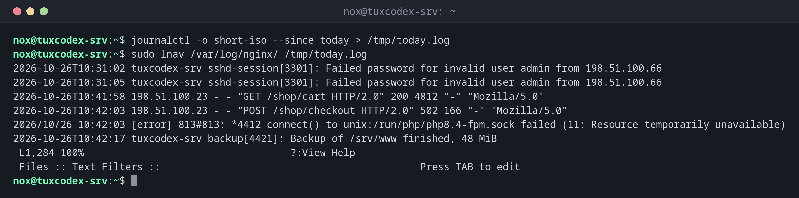

# lnav

> The log file navigator: merges several log files into one timeline, highlights errors, filters and even answers SQL queries about logs.



## Syntax

```bash
lnav [OPTION]... [FILE | DIRECTORY]...
```

## Options

| Option | Description |
|--------|-------------|
| `FILE...`, `DIRECTORY` | Open these logs, also compressed `.gz` files |
| `-r` | Open directories recursively |
| `-t` | Prefix lines from standard input with a time stamp |
| `-n` | Headless: no interface, e.g. with `-c` for scripts |
| `-c COMMAND` | Run a command, e.g. a filter or SQL query |

Keys inside `lnav`: ++e++ / ++shift+e++ next and previous error, ++w++ next warning, ++slash++ search, `:filter-in PATTERN` show only matching lines, `;` SQL query, ++q++ quit.

## Examples

**Open several logs in one timeline:**

```bash
journalctl -o short-iso --since today > /tmp/today.log
sudo lnav /var/log/nginx/ /tmp/today.log
```

```text
2026-10-26T10:31:02 tuxcodex-srv sshd-session[3301]: Failed password for invalid user admin from 198.51.100.66
2026-10-26T10:31:05 tuxcodex-srv sshd-session[3301]: Failed password for invalid user admin from 198.51.100.66
2026-10-26T10:41:58 198.51.100.23 - - "GET /shop/cart HTTP/2.0" 200 4812 "-" "Mozilla/5.0"
2026-10-26T10:42:03 198.51.100.23 - - "POST /shop/checkout HTTP/2.0" 502 166 "-" "Mozilla/5.0"
2026/10/26 10:42:03 [error] 813#813: *4412 connect() to unix:/run/php/php8.4-fpm.sock failed (11: Resource temporarily unavailable)
2026-10-26T10:42:17 tuxcodex-srv backup[4421]: Backup of /srv/www finished, 48 MiB
 L1,284 100%                                   ?:View Help
 Files :: Text Filters ::                                            Press TAB to edit
```

The checkout fails with `502` because PHP-FPM doesn't accept more connections. Both
lines are next to each other, although they come from two files.

**Inside lnav: show only matching lines with `:filter-in`:**

```bash
:filter-in " 502 "
```

```text
2026-10-26T10:42:03 198.51.100.23 - - "POST /shop/checkout HTTP/2.0" 502 166 "-" "Mozilla/5.0"
2026-10-26T10:42:09 192.0.2.45 - - "POST /shop/checkout HTTP/2.0" 502 166 "-" "Mozilla/5.0"
 L41 100%                                      ?:View Help
 Files :: Text Filters ::                                            Press TAB to edit
```

**Inside lnav: count server errors per client with SQL:**

```bash
;SELECT c_ip, count(*) AS hits FROM access_log WHERE sc_status >= 500 GROUP BY c_ip ORDER BY hits DESC
```

```text
 c_ip           hits
198.51.100.23     14
192.0.2.45         3
```

## When do I need it?

- When a problem involves several services and you want to see their logs in one timeline
- To jump through errors and warnings quickly
- To analyse web server logs with SQL, without exporting them first

!!! tip "Open a whole directory"
    `lnav /var/log/nginx` opens all files, including rotated and compressed ones, and sorts
    them by time.

!!! tip "Journal as well"
    `journalctl -o short-iso -f | lnav` shows the journal in lnav, with highlighting and
    error jumps.

## Distribution differences

| | Debian | Ubuntu | RHEL | Arch |
|---|--------|--------|------|------|
| Package | `lnav` | `lnav` | from EPEL | `lnav` |

## Related commands

[less](../04-viewing-files/less.md) · [goaccess](goaccess.md) · [journalctl](../09-systemd/journalctl.md)
