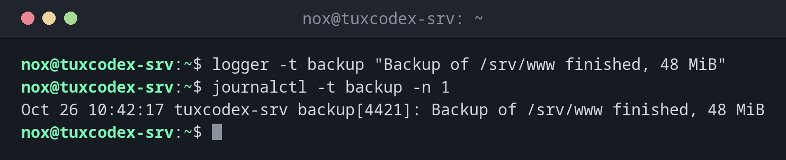

# logger

> Schreibt eigene Meldungen ins Systemlog. Der einfachste Weg, damit Skripte und Cronjobs Spuren im Journal hinterlassen.



## Syntax

```bash
logger [OPTION]... [NACHRICHT]
```

## Optionen

| Option | Beschreibung |
|--------|--------------|
| `-t TAG` | Name, unter dem die Meldung erscheint, z. B. `backup` |
| `-p PRIORITÄT` | Priorität, z. B. `user.err` oder `local0.info` |
| `-i` | Die Prozess-ID hinzufügen |
| `-f DATEI` | Den Inhalt einer Datei protokollieren |
| `-s` | Die Meldung zusätzlich auf der Standardfehlerausgabe ausgeben |

## Beispiele

**Eine Meldung mit Tag schreiben:**

```bash
logger -t backup "Backup of /srv/www finished, 48 MiB"
journalctl -t backup -n 1
```

```text
Oct 26 10:42:17 tuxcodex-srv backup[4421]: Backup of /srv/www finished, 48 MiB
```

**Einen Fehler protokollieren:**

```bash
logger -t backup -p user.err "Backup failed: no space left on /mnt/backup"
journalctl -t backup -p err -n 1
```

```text
Oct 26 10:42:19 tuxcodex-srv backup[4425]: Backup failed: no space left on /mnt/backup
```

**Den Inhalt einer Datei protokollieren:**

```bash
logger -t deploy -f /srv/app/deploy.log
journalctl -t deploy -n 2
```

```text
Oct 26 10:42:21 tuxcodex-srv deploy[4433]: Deployment of version 2.4.1 started
Oct 26 10:42:21 tuxcodex-srv deploy[4433]: Deployment of version 2.4.1 finished
```

Jede Zeile der Datei wird ein eigener Eintrag im Journal.

## Wann brauche ich das?

- In Skripten und Cronjobs, um Start, Ende und Fehler zu protokollieren
- Um einen Zeitpunkt im Log zu markieren, etwa vor einem Test
- Um zu prüfen, ob das Protokollieren überhaupt funktioniert

!!! tip "Eigene Meldungen wiederfinden"
    Nimm pro Skript ein festes Tag. `journalctl -t backup` zeigt dann genau die Meldungen
    deines Backup-Skripts, egal wie viel sonst los ist.

!!! tip "Fehler mit Priorität `err`"
    `logger -p user.err` markiert eine Meldung als Fehler. Monitoring und `journalctl -p err`
    finden sie dann zusammen mit den Fehlern aller Dienste.

## Verwandte Befehle

[systemd-cat](systemd-cat.md) · [journalctl](../09-systemd/journalctl.md)
