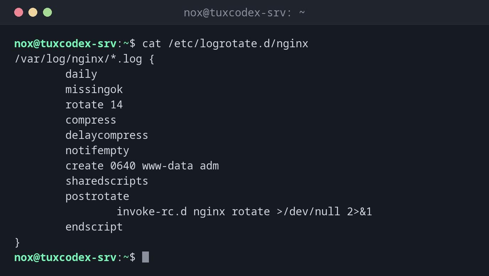

# logrotate

> Rotates, compresses and deletes log files according to rules, so they don't fill the disk. Runs automatically once a day.



## Syntax

```bash
logrotate [OPTION]... CONFIG_FILE
```

## Options

| Option | Description |
|--------|-------------|
| `-d` | Debug: only show what would happen, change nothing |
| `-v` | Verbose: show what is done |
| `-f` | Force: rotate now, even if it isn't due yet |

Important settings in a rule: `daily`/`weekly` interval, `rotate N` number of old files, `compress` compress them, `delaycompress` keep the newest old file uncompressed, `create` permissions of the new file, `postrotate` command afterwards, e.g. to make the service reopen its log.

## Examples

**The rule for nginx:**

```bash
cat /etc/logrotate.d/nginx
```

```text
/var/log/nginx/*.log {
        daily
        missingok
        rotate 14
        compress
        delaycompress
        notifempty
        create 0640 www-data adm
        sharedscripts
        postrotate
                invoke-rc.d nginx rotate >/dev/null 2>&1
        endscript
}
```

**Test a rule without changing anything:**

```bash
sudo logrotate -d /etc/logrotate.d/nginx
```

```text
warning: logrotate in debug mode does nothing except printing debug messages!  Consider using verbose mode (-v) instead if this is not what you want.

reading config file /etc/logrotate.d/nginx
Reading state from file: /var/lib/logrotate/status
Allocating hash table for state file, size 64 entries

Handling 1 logs

rotating pattern: /var/log/nginx/*.log after 1 days empty log files are not rotated, (14 rotations), old logs are removed
considering log /var/log/nginx/access.log
  Now: 2026-10-26 10:42
  Last rotated at 2026-10-26 00:00
  log does not need rotating (log has already been rotated)
considering log /var/log/nginx/error.log
  Now: 2026-10-26 10:42
  Last rotated at 2026-10-26 00:00
  log does not need rotating (log has already been rotated)
not running postrotate script, since no logs were rotated
```

**Rotate now and watch what happens:**

```bash
sudo logrotate -vf /etc/logrotate.d/nginx 2>&1 | tail -n 8
```

```text
renaming /var/log/nginx/access.log.1 to /var/log/nginx/access.log.2 (rotatecount 14, logstart 1, i 1),
renaming /var/log/nginx/access.log to /var/log/nginx/access.log.1
creating new /var/log/nginx/access.log mode = 0640 uid = 33 gid = 4
renaming /var/log/nginx/error.log.1 to /var/log/nginx/error.log.2 (rotatecount 14, logstart 1, i 1),
renaming /var/log/nginx/error.log to /var/log/nginx/error.log.1
creating new /var/log/nginx/error.log mode = 0640 uid = 33 gid = 4
running postrotate script
compressing log with: /bin/gzip
```

## When do I need it?

- When log files fill the disk because they are never rotated
- For your own application that writes log files
- To check a new rule before the nightly run

!!! tip "When does it run?"
    On systems with systemd, `logrotate.timer` starts it once a day:
    `systemctl list-timers logrotate.timer` shows when.

!!! warning "The service must reopen its log"
    After renaming, many services keep writing into the old file (`access.log.1`). That's
    what `postrotate` is for: it tells the service to open a new file. Without it, the new
    file stays empty.

## Related commands

[du](../13-disks-storage/du.md) · [gzip](../14-archives/gzip.md) · [zless](../04-viewing-files/zless.md)
