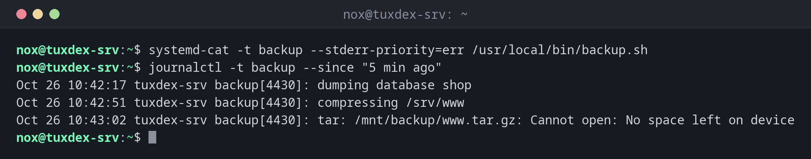

# systemd-cat

> Sends the output of a command or script into the systemd journal, with a tag and a priority.



## Syntax

```bash
systemd-cat [OPTION]... [COMMAND [ARGUMENT]...]
```

Either `systemd-cat` runs the command itself, or it reads from a pipe.

## Options

| Option | Description |
|--------|-------------|
| `-t TAG` | Name in the journal |
| `-p PRIORITY` | Priority for standard output, e.g. `info` |
| `--stderr-priority=PRIORITY` | Separate priority for error output, e.g. `err` |

## Examples

**Run a script and log its output:**

```bash
systemd-cat -t backup --stderr-priority=err /usr/local/bin/backup.sh
journalctl -t backup --since "5 min ago"
```

```text
Oct 26 10:42:17 tuxdex-srv backup[4430]: dumping database shop
Oct 26 10:42:51 tuxdex-srv backup[4430]: compressing /srv/www
Oct 26 10:43:02 tuxdex-srv backup[4430]: tar: /mnt/backup/www.tar.gz: Cannot open: No space left on device
```

**Only the errors of the run:**

```bash
journalctl -t backup -p err --since "5 min ago"
```

```text
Oct 26 10:43:02 tuxdex-srv backup[4430]: tar: /mnt/backup/www.tar.gz: Cannot open: No space left on device
```

**Send the output of a pipe to the journal:**

```bash
df -h /mnt/backup | systemd-cat -t diskcheck
journalctl -t diskcheck -n 2
```

```text
Oct 26 10:43:10 tuxdex-srv diskcheck[4442]: Filesystem      Size  Used Avail Use% Mounted on
Oct 26 10:43:10 tuxdex-srv diskcheck[4442]: /dev/sdb1        98G   98G     0 100% /mnt/backup
```

## When do I need it?

- To log the complete output of a script, not only single lines
- In cron jobs, so that output doesn't end up in mails but in the journal
- To separate normal output and errors by priority

!!! tip "Errors with their own priority"
    With `--stderr-priority=err`, everything a script writes to standard error appears as an
    error in the journal, and `journalctl -p err` finds it.

## Related commands

[logger](logger.md) · [journalctl](../09-systemd/journalctl.md) · [systemd-run](../09-systemd/systemd-run.md)
