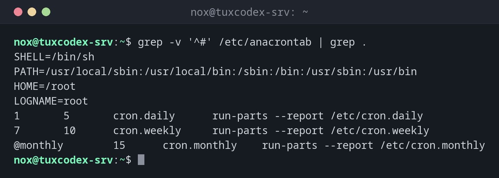

# anacron

> Runs daily, weekly and monthly jobs even if the server was switched off at the scheduled time: missed runs are caught up after booting.



## Syntax

```bash
anacron [OPTION]...
```

## Options

| Option | Description |
|--------|-------------|
| `-T` | Check `/etc/anacrontab` for errors |
| `-f` | Force: run all jobs now, regardless of when they last ran |
| `-n` | Now: don't wait for the delay |
| `-d` | Run in the foreground and print messages |

Each line of `/etc/anacrontab`: period in days, delay in minutes, a name, the command. The time of the last run is kept in `/var/spool/anacron/`.

## Examples

**Show the configuration:**

```bash
grep -v '^#' /etc/anacrontab | grep .
```

```text
SHELL=/bin/sh
PATH=/usr/local/sbin:/usr/local/bin:/sbin:/bin:/usr/sbin:/usr/bin
HOME=/root
LOGNAME=root
1       5       cron.daily      run-parts --report /etc/cron.daily
7       10      cron.weekly     run-parts --report /etc/cron.weekly
@monthly        15      cron.monthly    run-parts --report /etc/cron.monthly
```

`cron.daily` runs if it hasn't run for one day, 5 minutes after anacron starts.

**Check the configuration for errors:**

```bash
sudo anacron -T && echo "anacrontab ok"
```

```text
anacrontab ok
```

**Show when the jobs last ran:**

```bash
sudo head /var/spool/anacron/*
```

```text
==> /var/spool/anacron/cron.daily <==
20261026

==> /var/spool/anacron/cron.monthly <==
20261001

==> /var/spool/anacron/cron.weekly <==
20261026
```

## When do I need it?

- On servers and VMs that are not always running, e.g. test systems
- To make sure weekly and monthly jobs don't get lost after downtime
- To find out why daily jobs run at an unexpected time

!!! tip "Check when a job last ran"
    `cat /var/spool/anacron/cron.daily` shows the date of the last daily run, e.g.
    `20261026`.

## Distribution differences

| | Debian | Ubuntu | RHEL | Arch |
|---|--------|--------|------|------|
| Installed by default | no, package `anacron` | no, package `anacron` | yes, `cronie-anacron` | with the package `cronie` |

## Related commands

[crontab](crontab.md) · [run-parts](run-parts.md) · [systemctl](../09-systemd/systemctl.md)
