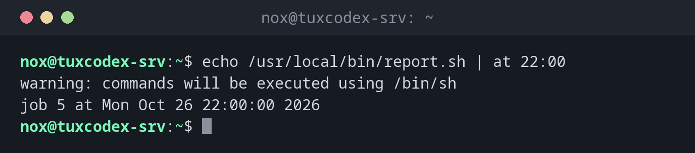

# at

> Führt einen Befehl einmal zu einer bestimmten Zeit aus. Das Gegenstück zu cron für einmalige Jobs.



## Syntax

```bash
at [OPTION]... ZEIT
```

`at` liest die Befehle von der Standardeingabe: Übergib sie mit `echo ... |` oder tippe sie ein und schließe mit ++ctrl+d++ ab. Der Dienst `atd` muss laufen.

## Optionen

| Option | Beschreibung |
|--------|--------------|
| `ZEIT` | z. B. `22:00`, `now + 2 hours`, `09:00 tomorrow`, `10:00 2026-11-02` |
| `-f DATEI` | Die Befehle aus einer Datei statt der Standardeingabe lesen |
| `-m` | Eine Mail schicken, wenn der Job gelaufen ist, auch ohne Ausgabe |
| `-l`, `-r`, `-c` | Wie `atq`, `atrm` und den Inhalt eines Jobs zeigen |

## Beispiele

**Ein Skript heute Abend um 22:00 ausführen:**

```bash
echo /usr/local/bin/report.sh | at 22:00
```

```text
warning: commands will be executed using /bin/sh
job 5 at Mon Oct 26 22:00:00 2026
```

Die Warnung ist normal: `at` nutzt `/bin/sh`, nicht deine Login-Shell.

**Einen Dienst in zwei Stunden neu starten:**

```bash
echo "systemctl restart php8.4-fpm" | sudo at now + 2 hours
```

```text
warning: commands will be executed using /bin/sh
job 6 at Mon Oct 26 12:42:00 2026
```

**Morgen früh:**

```bash
echo "/usr/local/bin/cleanup" | at 09:00 tomorrow
```

```text
warning: commands will be executed using /bin/sh
job 7 at Tue Oct 27 09:00:00 2026
```

**Eine Uhrzeit, die es nicht gibt:**

```bash
echo /usr/local/bin/report.sh | at 25:00
```

```text
Problem in hours specification. Last token seen: 25:00
Garbled time
```

## Wann brauche ich das?

- Um einmalig außerhalb der Arbeitszeit einen Dienst neu zu starten oder neu zu booten
- Um einen langen Job heute Nacht laufen zu lassen, ohne einen Cron-Eintrag anzulegen
- Um eine riskante Änderung automatisch zurückzunehmen, falls du den Zugang verlierst, etwa eine Firewall-Regel

!!! tip "Ein automatisches Rückgängig"
    Bevor du über SSH die Firewall änderst, plane das Rückgängigmachen ein:
    `echo "nft flush ruleset" | sudo at now + 5 minutes`. Klappt die Änderung, entferne den Job
    mit `atrm`. Sperrt sie dich aus, rettet dich der Job.

!!! warning "Nicht vorinstalliert"
    `at` und sein Dienst `atd` fehlen auf den meisten Distributionen. Installiere das Paket `at`
    und starte den Dienst mit `sudo systemctl enable --now atd`.

## Verwandte Befehle

[atq](atq.md) · [atrm](atrm.md) · [batch](batch.md) · [crontab](crontab.md)
