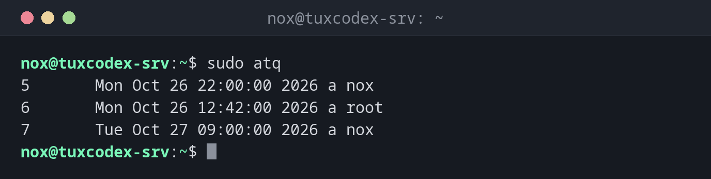

# atq

> Lists the jobs waiting in the `at` queue, with job number, time, queue and user.



## Syntax

```bash
atq [OPTION]...
```

## Options

| Option | Description |
|--------|-------------|
| *(none)* | Your own jobs; as root, the jobs of all users |
| `-q QUEUE` | Only one queue, e.g. `a` for `at` or `b` for `batch` |
| `at -c NUMBER` | Show the complete content of a job |

## Examples

**Show all waiting jobs:**

```bash
sudo atq
```

```text
5       Mon Oct 26 22:00:00 2026 a nox
6       Mon Oct 26 12:42:00 2026 a root
7       Tue Oct 27 09:00:00 2026 a nox
```

The columns: job number, time, queue (`a` for `at`), user.

**Show the command of a job:**

```bash
at -c 5 | tail -n 2
```

```text
}
/usr/local/bin/report.sh
```

**No jobs waiting:**

```bash
atq | wc -l
```

```text
0
```

## When do I need it?

- To check whether a planned job is in the queue
- Before removing a job with `atrm`, to find its number
- To see what other admins have scheduled (as root)

!!! tip "See what a job really does"
    `at -c` shows the whole job, including all environment variables that `at` saved.
    The actual command is at the very end.

## Related commands

[at](at.md) · [atrm](atrm.md) · [batch](batch.md)
