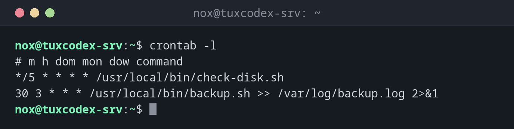

# crontab

> Shows and edits the cron jobs of a user: commands that run regularly at fixed times.



## Syntax

```bash
crontab [OPTION]... [FILE]
```

The time syntax with its five fields is explained in the [basics](basics.md).

## Options

| Option | Description |
|--------|-------------|
| `-l` | Show the crontab |
| `-e` | Edit the crontab in the editor |
| `-r` | Delete the whole crontab |
| `-u USER` | The crontab of another user (root) |
| `FILE`, `-` | Install a crontab from a file or from standard input |

## Examples

**Show the own crontab:**

```bash
crontab -l
```

```text
# m h dom mon dow command
*/5 * * * * /usr/local/bin/check-disk.sh
30 3 * * * /usr/local/bin/backup.sh >> /var/log/backup.log 2>&1
```

**A user without a crontab:**

```bash
crontab -l -u alice
```

```text
no crontab for alice
```

**Edit the crontab:**

```bash
crontab -e
```

```text
crontab: installing new crontab
```

After saving and closing the editor, the new crontab is active immediately.

**A mistake in the time fields:**

```bash
crontab -e
```

```text
crontab: installing new crontab
"/tmp/crontab.dIi22M/crontab":2: bad minute
errors in crontab file, can't install.
Do you want to retry the same edit? (y/n) y
```

`61` is not a valid minute. `crontab` refuses to install the faulty version and lets you
correct it.

## When do I need it?

- To run a script regularly, e.g. a backup every night
- To check which jobs a user has scheduled
- When a job doesn't run: is the line there, and is it correct?

!!! tip "Set the editor"
    `crontab -e` uses the editor from `$EDITOR`. With `EDITOR=nano crontab -e`, you choose it
    for this one call.

!!! danger "`-r` deletes without asking"
    `-r` sits right next to `-e` on the keyboard and deletes the whole crontab immediately. Save
    it regularly: `crontab -l > ~/crontab.backup`.

## Related commands

[run-parts](run-parts.md) · [anacron](anacron.md) · [at](at.md) · [flock](flock.md)
