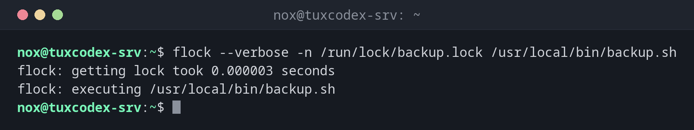

# flock

> Runs a command only while holding a lock file. Prevents a cron job from starting a second time while the first run is still going.



## Syntax

```bash
flock [OPTION]... LOCKFILE COMMAND [ARGUMENT]...
```

## Options

| Option | Description |
|--------|-------------|
| `-n` | Don't wait: give up at once if the lock is taken |
| `-w SECONDS` | Wait at most this long for the lock |
| `-E CODE` | Exit code when the lock is taken, default `1` |
| `--verbose` | Report how long getting the lock took |

## Examples

**Run a backup with a lock:**

```bash
flock --verbose -n /run/lock/backup.lock /usr/local/bin/backup.sh
```

```text
flock: getting lock took 0.000003 seconds
flock: executing /usr/local/bin/backup.sh
```

**A second start while the first is running:**

```bash
flock -n /run/lock/backup.lock /usr/local/bin/backup.sh; echo "exit $?"
```

```text
exit 1
```

The second backup doesn't start at all.

**Wait up to 30 seconds for the lock:**

```bash
flock -w 30 /run/lock/backup.lock echo "got the lock"
```

```text
got the lock
```

**Use the lock inside a script:**

```bash
exec 9>/run/lock/backup.lock
flock -n 9 || { echo "backup already running"; exit 1; }
```

```text
backup already running
```

The lock is held as long as the script runs and is released automatically at the end.

## When do I need it?

- For cron jobs that can take longer than their interval, e.g. a backup every hour
- For scripts that must never run twice at the same time
- To serialise jobs that use the same resource

!!! tip "In a crontab"
    `*/10 * * * * flock -n /run/lock/sync.lock /usr/local/bin/sync.sh` starts the sync every
    10 minutes, but never a second one while the first is still running.

!!! tip "Silent in cron"
    With `-n -E 0`, a skipped run exits with `0`, so cron and monitoring don't treat it as
    an error.

## Related commands

[crontab](crontab.md) · [timeout](../08-processes/timeout.md) · [systemd-run](../09-systemd/systemd-run.md)
