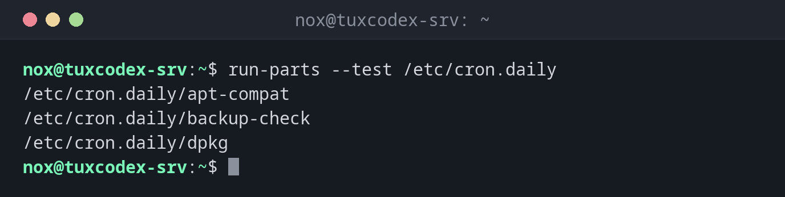

# run-parts

> Runs all executable scripts in a directory, one after the other. That's how `/etc/cron.daily/` and the other period directories work.



## Syntax

```bash
run-parts [OPTION]... DIRECTORY
```

`run-parts` ignores file names with dots, so `backup.sh` is skipped. Name scripts in these directories without an extension, e.g. `backup-check`.

## Options

| Option | Description |
|--------|-------------|
| `--test` | Only show which scripts would run |
| `--list` | List all scripts that match the naming rules |
| `--report` | Print the name of a script before its output |
| `--exit-on-error` | Stop at the first failed script |

## Examples

**Show which daily scripts would run:**

```bash
run-parts --test /etc/cron.daily
```

```text
/etc/cron.daily/apt-compat
/etc/cron.daily/backup-check
/etc/cron.daily/dpkg
```

**A script with an extension is ignored:**

```bash
ls /etc/cron.daily
run-parts --test /etc/cron.daily
```

```text
apt-compat  backup-check  cleanup.sh  dpkg
/etc/cron.daily/apt-compat
/etc/cron.daily/backup-check
/etc/cron.daily/dpkg
```

`cleanup.sh` is missing in the list. Rename it to `cleanup`.

**Run all daily scripts now:**

```bash
sudo run-parts --report /etc/cron.daily
```

```text
/etc/cron.daily/backup-check:
last backup: 2026-10-26 03:30, 48 MiB, OK
```

## When do I need it?

- To check which daily, weekly or monthly scripts run
- When a script in `/etc/cron.daily/` doesn't run: is it executable, and is the name valid?
- To test the daily scripts by hand

!!! warning "No dots in the name"
    A script called `backup-check.sh` is silently ignored by `run-parts` on Debian and
    Ubuntu. `run-parts --test` shows whether a script is picked up.

## Distribution differences

| | Debian | Ubuntu | RHEL | Arch |
|---|--------|--------|------|------|
| Ignores names with dots | yes | yes | no | no |

## Related commands

[crontab](crontab.md) · [anacron](anacron.md)
