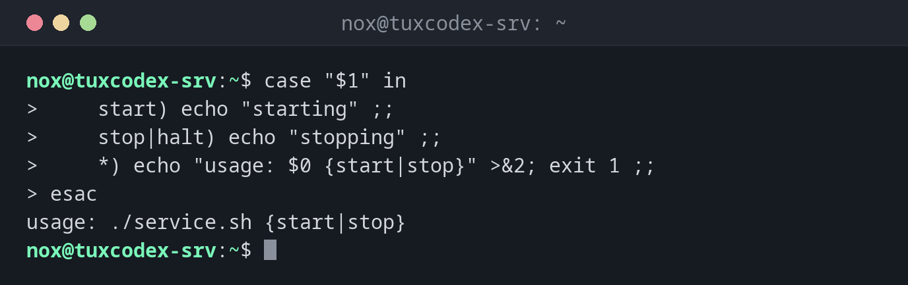

# case

> Vergleicht einen Wert mit mehreren Mustern und führt den Block des ersten Treffers aus. Übersichtlicher als eine lange `if`/`elif`-Kette.



## Syntax

```bash
case WERT in
    MUSTER1) … ;;
    MUSTER2|MUSTER3) … ;;
    *) … ;;
esac
```

## Optionen

| Teil | Bedeutung |
|------|-----------|
| `MUSTER)` | Ein Muster mit `*`, `?` und `[…]`, wie bei Dateinamen |
| `A|B)` | Mehrere Alternativen |
| `;;` | Ende des Blocks |
| `*)` | Alles andere, der Standardfall |
| `esac` | Ende von `case` |

## Beispiele

**Unterbefehle eines Skripts:**

```bash
case "$1" in
    start) echo "starting" ;;
    stop|halt) echo "stopping" ;;
    *) echo "usage: $0 {start|stop}" >&2; exit 1 ;;
esac
```

```text
usage: ./service.sh {start|stop}
```

Das Skript wurde ohne Argument aufgerufen, deshalb greift der `*)`-Fall.

**Den Entpack-Befehl nach Dateiendung wählen:**

```bash
file=backup.tar.zst
case "$file" in
    *.tar.gz|*.tgz) echo "tar -xzf" ;;
    *.tar.zst) echo "tar --zstd -xf" ;;
    *.zip) echo "unzip" ;;
    *) echo "unknown format" ;;
esac
```

```text
tar --zstd -xf
```

**Mehrere Antworten annehmen:**

```bash
read -r -p "Continue? [y/n] " a
case "$a" in
    [yY]|[yY][eE][sS]) echo "continuing" ;;
    *) echo "aborted" ;;
esac
```

```text
Continue? [y/n] yes
continuing
```

## Wann brauche ich das?

- Für Skripte mit Unterbefehlen wie `start`, `stop`, `status`
- Um auf Dateiendungen oder Muster in Hostnamen zu reagieren
- Für Menüs und Antworten wie `y`, `yes`, `n`

!!! tip "Immer ein `*)`-Fall"
    Ein abschließendes `*)` fängt unerwartete Werte ab, meist mit einer Gebrauchsanweisung und
    `exit 1`.

## Verwandte Befehle

[if](if.md) · [test](test.md) · [getopts](getopts.md)
