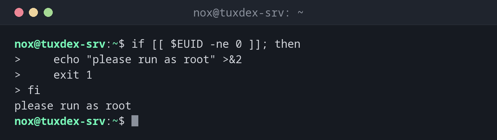

# exit

> Ends a script with an exit code: `0` for success, everything else for an error. Callers, cron and monitoring evaluate this code.



## Syntax

```bash
exit [CODE]
```

Without `exit`, a script ends with the exit code of its last command.

## Options

| Code | Usual meaning |
|------|---------------|
| `0` | Success |
| `1` | General error |
| `2` | Wrong usage, e.g. missing arguments |
| `126`, `127` | Command not executable, command not found |
| `128 + N` | Ended by signal `N`, e.g. `130` for ++ctrl+c++ |
| `$?` | Exit code of the last command |

## Examples

**Check a requirement and stop:**

```bash
if [[ $EUID -ne 0 ]]; then
    echo "please run as root" >&2
    exit 1
fi
```

```text
please run as root
```

**Check the exit code of a script:**

```bash
./backup-www /nope; echo "exit code: $?"
```

```text
10:42:17 Source /nope does not exist
exit code: 1
```

**A command that doesn't exist:**

```bash
backupp; echo $?
```

```text
bash: backupp: command not found
127
```

## When do I need it?

- At the end of every check: did it work or not?
- To stop a script early when a requirement is missing
- So that cron, systemd and monitoring can recognise failed runs

!!! tip "Fail early"
    Check requirements at the start and stop with a clear message and `exit 1`. That's easier
    to debug than an error halfway through.

!!! warning "`exit` in a sourced file"
    In a file loaded with `source`, `exit` closes your whole shell. Use `return` there.

## Related commands

[function](function.md) · [set](set.md) · [trap](trap.md) · [getopts](getopts.md)
