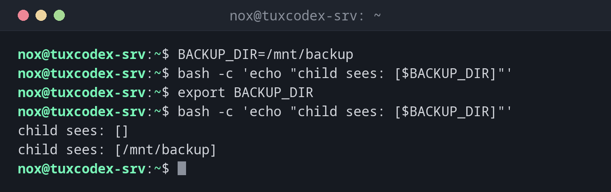

# export

> Makes a variable available to programs and scripts started from the current shell (environment variable).



## Syntax

```bash
export NAME[=VALUE]...
```

A normal variable only exists in the current shell. Only exported variables are passed on to child processes.

## Options

| Option | Description |
|--------|-------------|
| `NAME=VALUE` | Set and export in one step |
| `-p` | List all exported variables |
| `-n NAME` | Remove the export, keep the variable |

## Examples

**Without and with `export`:**

```bash
BACKUP_DIR=/mnt/backup
bash -c 'echo "child sees: [$BACKUP_DIR]"'
export BACKUP_DIR
bash -c 'echo "child sees: [$BACKUP_DIR]"'
```

```text
child sees: []
child sees: [/mnt/backup]
```

**Show the exported variable:**

```bash
export -p | grep BACKUP
```

```text
declare -x BACKUP_DIR="/mnt/backup"
```

**Set the editor for all programs:**

```bash
export EDITOR=vim
echo "$EDITOR"
```

```text
vim
```

## When do I need it?

- To configure a program through environment variables, e.g. `EDITOR` or `http_proxy`
- To pass settings to scripts started from your script
- In `~/.bashrc`, to set variables for every new shell

!!! tip "Only for one command"
    `BACKUP_DIR=/mnt/backup ./backup.sh` sets the variable only for this one command, without
    `export` and without changing your shell.

!!! warning "Exported variables don't go back"
    A script can't change the variables of the shell that started it. To load variables
    into the current shell, use [`source`](source.md).

## Related commands

[source](source.md)
