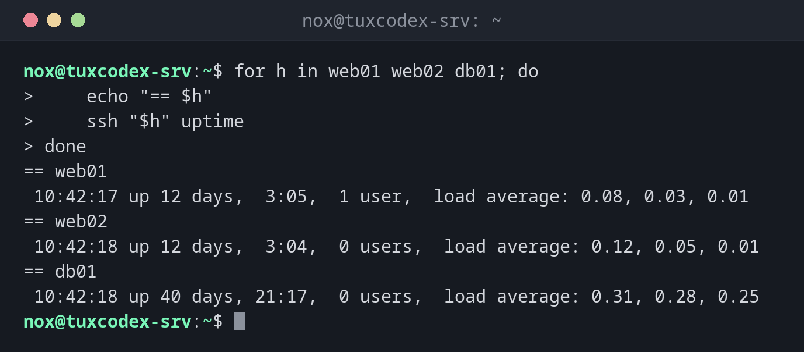

# for

> Wiederholt Befehle für jedes Element einer Liste: Server, Dateien, Zahlen.



## Syntax

```bash
for NAME in LISTE; do
    …
done

for (( i = 0; i < N; i++ )); do
    …
done
```

## Optionen

| Form | Läuft über |
|------|------------|
| `for h in web01 web02` | Die angegebenen Wörter |
| `for f in /var/log/*.log` | Passende Dateien (Glob) |
| `for i in {1..10}` | Einen Zahlenbereich |
| `for (( i = 0; i < 3; i++ ))` | Einen Zähler, im Stil von C |
| `for a in "$@"` | Alle Argumente des Skripts |
| `break`, `continue` | Die Schleife verlassen, zum nächsten Element springen |

## Beispiele

**Einen Befehl auf mehreren Servern ausführen:**

```bash
for h in web01 web02 db01; do
    echo "== $h"
    ssh "$h" uptime
done
```

```text
== web01
 10:42:17 up 12 days,  3:05,  1 user,  load average: 0.08, 0.03, 0.01
== web02
 10:42:18 up 12 days,  3:04,  0 users,  load average: 0.12, 0.05, 0.01
== db01
 10:42:18 up 40 days, 21:17,  0 users,  load average: 0.31, 0.28, 0.25
```

**Alle alten Logs komprimieren:**

```bash
for f in /var/log/app/*.log.1; do
    gzip -v "$f"
done
```

```text
/var/log/app/api.log.1:  84.2% -- replaced with /var/log/app/api.log.1.gz
/var/log/app/worker.log.1:       79.6% -- replaced with /var/log/app/worker.log.1.gz
```

**Ein Zahlenbereich:**

```bash
for i in {1..3}; do
    echo "round $i"
done
```

```text
round 1
round 2
round 3
```

## Wann brauche ich das?

- Um denselben Befehl auf mehreren Servern oder Dateien auszuführen
- Um alle Dateien eines Verzeichnisses zu verarbeiten
- Für eine feste Anzahl an Wiederholungen

!!! tip "Globs statt `ls`"
    `for f in /var/log/*.log` ist sicher bei Dateinamen mit Leerzeichen. `for f in $(ls ...)`
    reißt sie auseinander.

!!! warning "Kein Treffer"
    Passt ein Glob auf nichts, läuft die Schleife einmal mit dem Muster selbst, z. B.
    `/var/log/*.log`. Prüfe mit `[[ -e $f ]] || continue` oder setze `shopt -s nullglob`.

## Verwandte Befehle

[while](while.md) · [if](if.md) · [find](../02-navigation/find.md) · [xargs](../05-text-processing/xargs.md)
