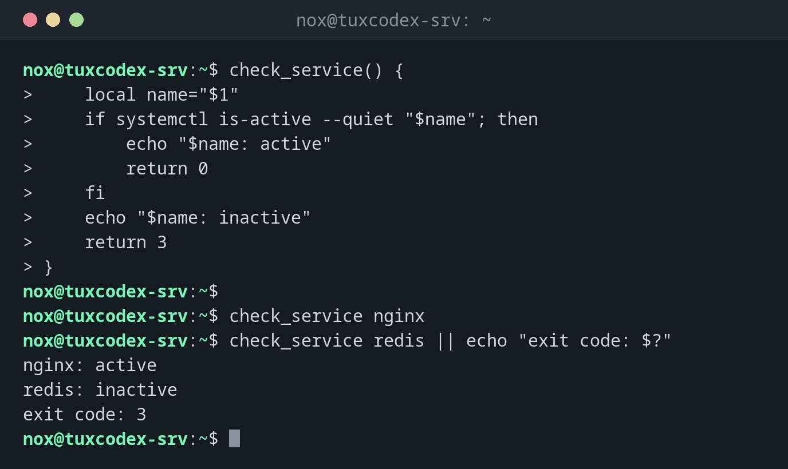

# function

> Definiert eine Funktion: einen benannten Block von Befehlen, den du wie einen Befehl aufrufst, mit Argumenten und Exit-Code.



## Syntax

```bash
NAME() {
    …
}
```

## Optionen

| Teil | Bedeutung |
|------|-----------|
| `NAME() { … }` | Die Funktion definieren (das Schlüsselwort `function` ist optional) |
| `$1`, `$2`, `"$@"` | Argumente der Funktion, wie in einem Skript |
| `local VAR=…` | Variable, die es nur innerhalb der Funktion gibt |
| `return N` | Die Funktion mit Exit-Code `N` beenden |
| `echo` darin | Die Ausgabe, die der Aufrufer mit `$(…)` auffangen kann |

## Beispiele

**Eine Funktion mit Argument und Exit-Code:**

```bash
check_service() {
    local name="$1"
    if systemctl is-active --quiet "$name"; then
        echo "$name: active"
        return 0
    fi
    echo "$name: inactive"
    return 3
}

check_service nginx
check_service redis || echo "exit code: $?"
```

```text
nginx: active
redis: inactive
exit code: 3
```

**Einen Wert als Ausgabe zurückgeben:**

```bash
disk_usage() {
    df --output=pcent "$1" | tail -n 1 | tr -dc 0-9
}
usage=$(disk_usage /)
echo "root is ${usage}% full"
```

```text
root is 50% full
```

**Eine kleine Log-Funktion:**

```bash
log() {
    printf '%(%T)T %s\n' -1 "$*"
}
log "backup started"
```

```text
10:42:17 backup started
```

## Wann brauche ich das?

- Wenn dieselben Schritte mehrmals in einem Skript vorkommen
- Um Teilen eines Skripts einen lesbaren Namen zu geben, etwa `log` oder `cleanup`
- Um Werte zurückzugeben: als Ausgabe mit `echo` oder als Erfolg oder Fehler mit `return`

!!! tip "Immer `local`"
    Ohne `local` überschreibt eine Variable in einer Funktion eine gleichnamige Variable im Rest
    des Skripts. Das führt zu schwer auffindbaren Fehlern.

!!! warning "`return` ist kein Ergebnis"
    `return` gibt nur einen Exit-Code von 0 bis 255 zurück. Text oder Zahlen gibst du mit `echo`
    aus und fängst sie auf: `groesse=$(get_size /srv)`.

## Verwandte Befehle

[exit](exit.md) · [source](source.md) · [if](if.md)
