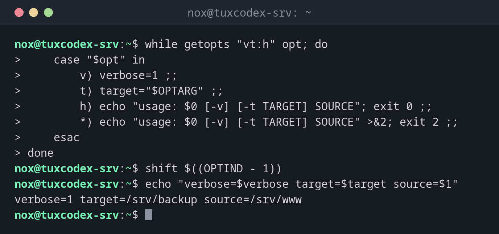

# getopts

> Liest kurze Optionen wie `-v` und `-t ZIEL` aus den Argumenten eines Skripts. Der Standardweg, Skripten Schalter zu geben.



## Syntax

```bash
getopts OPTIONSZEICHEN NAME
```

Diese Seite nutzt das Skript `backup.sh` mit der Schleife aus dem ersten Beispiel. `getopts` ist in Bash eingebaut; es kennt nur kurze Optionen.

## Optionen

| Teil | Bedeutung |
|------|-----------|
| `"vt:h"` | Erlaubte Optionen; ein `:` nach einem Buchstaben heißt: braucht einen Wert |
| `$opt` | Die in dieser Runde gefundene Option |
| `$OPTARG` | Der Wert einer Option mit `:` |
| `$OPTIND` | Index des nächsten Arguments |
| `shift $((OPTIND - 1))` | Die Optionen entfernen, damit `$1` das erste normale Argument ist |

## Beispiele

**Die Optionsschleife in `backup.sh`:**

```bash
while getopts "vt:h" opt; do
    case "$opt" in
        v) verbose=1 ;;
        t) target="$OPTARG" ;;
        h) echo "usage: $0 [-v] [-t TARGET] SOURCE"; exit 0 ;;
        *) echo "usage: $0 [-v] [-t TARGET] SOURCE" >&2; exit 2 ;;
    esac
done
shift $((OPTIND - 1))
echo "verbose=$verbose target=$target source=$1"
```

```text
verbose=1 target=/srv/backup source=/srv/www
```

Aufgerufen als `./backup.sh -v -t /srv/backup /srv/www`.

**Eine unbekannte Option:**

```bash
./backup.sh -x
```

```text
./backup.sh: illegal option -- x
usage: ./backup.sh [-v] [-t TARGET] SOURCE
```

**Eine Option ohne ihren Wert:**

```bash
./backup.sh -t
```

```text
./backup.sh: option requires an argument -- t
usage: ./backup.sh [-v] [-t TARGET] SOURCE
```

## Wann brauche ich das?

- Wenn ein Skript Schalter braucht, etwa einen ausführlichen Modus oder ein Zielverzeichnis
- Um falsche Optionen mit einer klaren Meldung abzulehnen
- Statt `$1`, `$2` von Hand zu prüfen

!!! tip "Eine Gebrauchsanweisung"
    Gib bei `-h` und bei falschen Optionen eine kurze Gebrauchszeile aus. Nimm Exit-Code `0`
    für `-h` und `2` für falsche Benutzung.

## Verwandte Befehle

[case](case.md) · [while](while.md) · [exit](exit.md)
