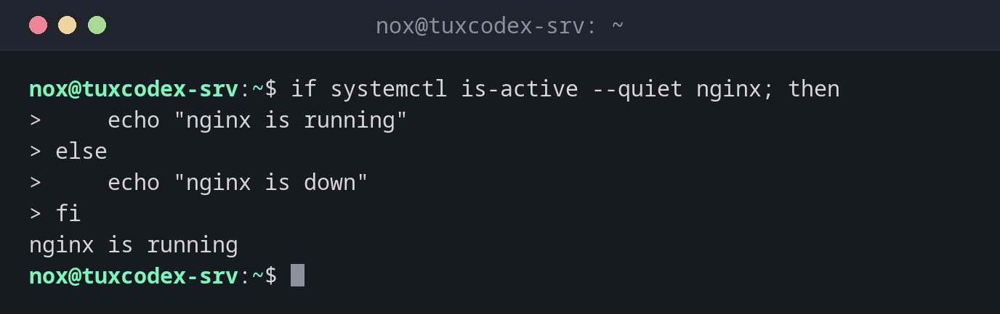

# if

> Führt Befehle nur aus, wenn eine Bedingung wahr ist. Die Bedingung ist ein beliebiger Befehl: `if` prüft seinen Exit-Code.



## Syntax

```bash
if BEFEHL; then
    …
elif BEFEHL; then
    …
else
    …
fi
```

## Optionen

| Teil | Bedeutung |
|------|-----------|
| `if BEFEHL; then` | Den Block ausführen, wenn `BEFEHL` mit `0` endet |
| `elif` | Weitere Bedingung, wenn die erste falsch ist |
| `else` | Block für alle anderen Fälle |
| `fi` | Ende der Bedingung |
| `if ! BEFEHL` | Verneinen: wenn der Befehl scheitert |

## Beispiele

**Auf den Zustand eines Dienstes reagieren:**

```bash
if systemctl is-active --quiet nginx; then
    echo "nginx is running"
else
    echo "nginx is down"
fi
```

```text
nginx is running
```

**Mehrere Fälle mit `elif`:**

```bash
usage=$(df --output=pcent / | tail -n 1 | tr -dc 0-9)
if (( usage >= 90 )); then
    echo "critical: ${usage}%"
elif (( usage >= 80 )); then
    echo "warning: ${usage}%"
else
    echo "ok: ${usage}%"
fi
```

```text
ok: 50%
```

**Handeln, wenn ein Befehl scheitert:**

```bash
if ! ping -c 1 -W 1 192.0.2.99 > /dev/null; then
    echo "192.0.2.99 not reachable"
fi
```

```text
192.0.2.99 not reachable
```

## Wann brauche ich das?

- Immer, wenn ein Skript entscheiden muss: Gibt es die Datei, hat der Befehl geklappt?
- Um das Ergebnis eines Befehls direkt zu prüfen, ohne `$?`
- Um klare Fehlermeldungen zu geben und das Skript früh zu beenden

!!! tip "Befehle direkt prüfen"
    `if grep -q error app.log` ist kürzer und sicherer, als `grep` auszuführen und danach `$?`
    zu prüfen.

!!! tip "Kurzform mit `&&` und `||`"
    Für einfache Fälle reicht `[[ -d $dir ]] || mkdir "$dir"`. Für alles mit mehr als einem
    Befehl ist `if` leichter zu lesen.

## Verwandte Befehle

[test](test.md) · [case](case.md) · [exit](exit.md) · [for](for.md) · [function](function.md)
