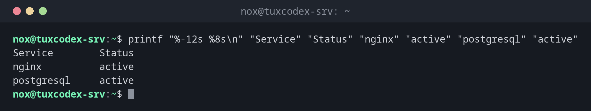

# printf

> Prints formatted text: columns, numbers with a fixed number of digits, padded values. More precise and more portable than `echo`.



## Syntax

```bash
printf FORMAT [ARGUMENT]...
```

The format is reused as long as there are arguments left. `printf` never adds a line break by itself.

## Options

| Option | Description |
|--------|-------------|
| `%s` | Insert a string |
| `%d` | Insert an integer |
| `%.2f` | Floating point number with two decimals |
| `%-12s`, `%8s` | Left or right aligned in a column of this width |
| `\n`, `\t` | New line, tab |
| `%%` | A literal percent sign |
| `%(%F %T)T` | Date and time (Bash), with `-1` for now |

## Examples

**An aligned table:**

```bash
printf "%-12s %8s\n" "Service" "Status" "nginx" "active" "postgresql" "active"
```

```text
Service        Status
nginx          active
postgresql     active
```

**Text with numbers:**

```bash
printf "Disk %s is %d%% full\n" /dev/sda2 50
```

```text
Disk /dev/sda2 is 50% full
```

**One line per argument:**

```bash
printf "%s\n" web01 web02 db01
```

```text
web01
web02
db01
```

**A time stamp for log lines:**

```bash
printf '%(%F %T)T backup started\n' -1
```

```text
2026-10-26 10:42:17 backup started
```

## When do I need it?

- For tables and aligned output in scripts
- For exact output without surprises, e.g. in files that other programs read
- Instead of `echo -e` and `echo -n`

!!! tip "Time stamps without `date`"
    `printf '%(%F %T)T\n' -1` prints the current date and time, without starting the program
    `date`.

## Related commands

[echo](echo.md) · [column](../05-text-processing/column.md) · [date](../01-orientation/date.md)
