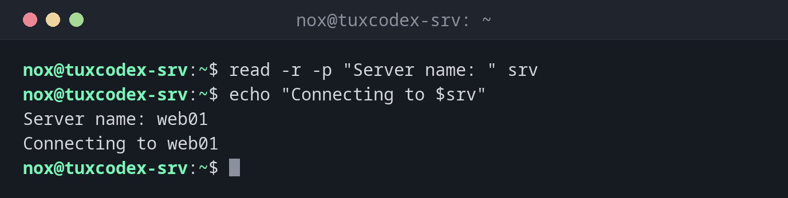

# read

> Reads a line from the keyboard or a file into variables. For questions to the user and for processing files line by line.



## Syntax

```bash
read [OPTION]... [VARIABLE]...
```

## Options

| Option | Description |
|--------|-------------|
| `-p TEXT` | Show a prompt |
| `-r` | Raw: don't treat backslashes as escapes (always use it) |
| `-s` | Silent: don't show the input, for passwords |
| `-t SECONDS` | Give up after this time |
| `-a ARRAY` | Read the words into an array |
| `IFS=:` | Separator for splitting the line, set just for `read` |

## Examples

**Ask for a value:**

```bash
read -r -p "Server name: " srv
echo "Connecting to $srv"
```

```text
Server name: web01
Connecting to web01
```

**Ask for a confirmation:**

```bash
read -r -p "Really delete? [y/N] " answer
[[ "$answer" == [yY] ]] && echo "deleting" || echo "aborted"
```

```text
Really delete? [y/N] n
aborted
```

**Read a file line by line:**

```bash
while read -r name ip; do
    echo "$name -> $ip"
done < hosts.txt
```

```text
web01 -> 192.0.2.10
web02 -> 192.0.2.11
```

**Split lines at a separator:**

```bash
while IFS=: read -r user _ uid _ _ home _; do
    (( uid >= 1000 && uid < 65534 )) && echo "$user $home"
done < /etc/passwd
```

```text
nox /home/nox
alice /home/alice
```

## When do I need it?

- For confirmations before risky steps: "Really delete?"
- To process files line by line, e.g. a list of servers
- To split lines into fields, e.g. `/etc/passwd`

!!! tip "Always `-r`"
    Without `-r`, `read` removes backslashes from the input. With `-r`, every line arrives
    exactly as it is.

!!! warning "Not in unattended scripts"
    A script with `read` waits for input forever when run by cron or systemd. Use `-t`, or
    ask only when standard input is a terminal: `[[ -t 0 ]]`.

## Related commands

[while](while.md) · [echo](echo.md) · [cut](../05-text-processing/cut.md)
