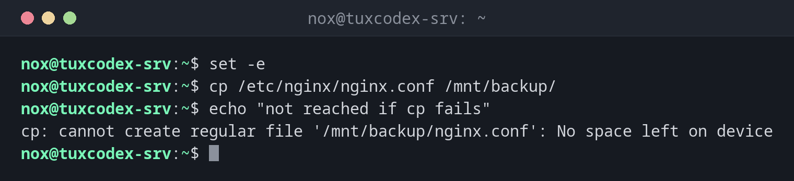

# set

> Changes how Bash behaves. In scripts, mainly to stop on errors instead of carrying on silently.



## Syntax

```bash
set [-euxo OPTION]
```

The usual start of a robust script is `set -euo pipefail`.

## Options

| Option | Description |
|--------|-------------|
| `-e` | Stop the script when a command fails |
| `-u` | Treat unset variables as an error |
| `-o pipefail` | A pipe fails if any part of it fails, not only the last |
| `-x` | Print every command before running it (debugging) |
| `+x` | Switch an option off again, here the debugging output |

## Examples

**Stop at the first error:**

```bash
set -e
cp /etc/nginx/nginx.conf /mnt/backup/
echo "not reached if cp fails"
```

```text
cp: cannot create regular file '/mnt/backup/nginx.conf': No space left on device
```

**Catch a typo in a variable:**

```bash
set -u
target=/mnt/backup
rm -rf "$targte/old"
```

```text
bash: targte: unbound variable
```

Without `set -u`, `"$targte/old"` would become `/old`, and `rm -rf` would delete it.

**Errors in the middle of a pipe:**

```bash
set -o pipefail
false | sort
echo "exit code: $?"
```

```text
exit code: 1
```

**Show what the script does:**

```bash
set -x
name=web01
echo "host $name"
```

```text
+ name=web01
+ echo 'host web01'
host web01
```

## When do I need it?

- At the start of every script, so that errors don't go unnoticed
- To find out where a script goes wrong, with `set -x`
- To catch typos in variable names with `set -u`

!!! tip "Debug a single part"
    Put `set -x` before and `set +x` after the part you want to examine. Or run the whole
    script with `bash -x script.sh`.

!!! warning "`-e` has exceptions"
    `set -e` doesn't stop in conditions (`if`, `&&`, `||`) or for commands whose failure is
    expected there. That's intended, but it means you still have to check important steps.

## Related commands

[trap](trap.md) · [exit](exit.md) · [shellcheck](shellcheck.md)
