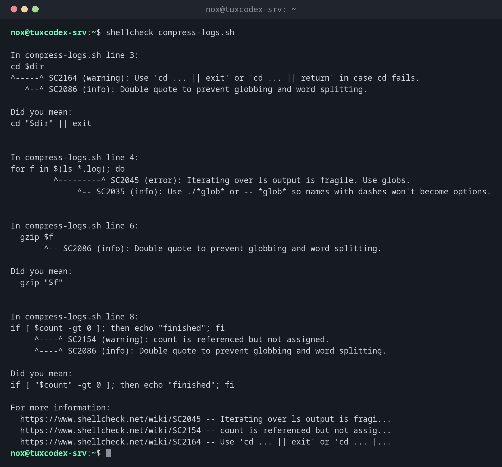

# shellcheck

> Checks shell scripts for errors and risky constructs before they run: missing quotes, unset variables, typos and many classic traps.



## Syntax

```bash
shellcheck [OPTION]... SCRIPT...
```

Every finding has a code like `SC2086`. `https://www.shellcheck.net/wiki/SC2086` explains it with examples.

## Options

| Option | Description |
|--------|-------------|
| `-f gcc` | Short output, one line per finding |
| `-S warning` | Only warnings and errors, no style notes |
| `-e SC2086` | Ignore this check |
| `-x` | Follow files loaded with `source` |

## Examples

**Check a script:**

```bash
shellcheck compress-logs.sh
```

```text

In compress-logs.sh line 3:
cd $dir
^-----^ SC2164 (warning): Use 'cd ... || exit' or 'cd ... || return' in case cd fails.
   ^--^ SC2086 (info): Double quote to prevent globbing and word splitting.

Did you mean:
cd "$dir" || exit


In compress-logs.sh line 4:
for f in $(ls *.log); do
         ^---------^ SC2045 (error): Iterating over ls output is fragile. Use globs.
              ^-- SC2035 (info): Use ./*glob* or -- *glob* so names with dashes won't become options.


In compress-logs.sh line 6:
  gzip $f
       ^-- SC2086 (info): Double quote to prevent globbing and word splitting.

Did you mean:
  gzip "$f"


In compress-logs.sh line 8:
if [ $count -gt 0 ]; then echo "finished"; fi
     ^----^ SC2154 (warning): count is referenced but not assigned.
     ^----^ SC2086 (info): Double quote to prevent globbing and word splitting.

Did you mean:
if [ "$count" -gt 0 ]; then echo "finished"; fi

For more information:
  https://www.shellcheck.net/wiki/SC2045 -- Iterating over ls output is fragi...
  https://www.shellcheck.net/wiki/SC2154 -- count is referenced but not assig...
  https://www.shellcheck.net/wiki/SC2164 -- Use 'cd ... || exit' or 'cd ... |...
```

**The script that was checked:**

```bash
cat compress-logs.sh
```

```text
#!/usr/bin/env bash
dir=$1
cd $dir
for f in $(ls *.log); do
  echo "Compressing $f"
  gzip $f
done
if [ $count -gt 0 ]; then echo "finished"; fi
```

**Short output, one line per finding:**

```bash
shellcheck -f gcc compress-logs.sh
```

```text
compress-logs.sh:3:1: warning: Use 'cd ... || exit' or 'cd ... || return' in case cd fails. [SC2164]
compress-logs.sh:3:4: note: Double quote to prevent globbing and word splitting. [SC2086]
compress-logs.sh:4:10: error: Iterating over ls output is fragile. Use globs. [SC2045]
compress-logs.sh:4:15: note: Use ./*glob* or -- *glob* so names with dashes won't become options. [SC2035]
compress-logs.sh:6:8: note: Double quote to prevent globbing and word splitting. [SC2086]
compress-logs.sh:8:6: warning: count is referenced but not assigned. [SC2154]
compress-logs.sh:8:6: note: Double quote to prevent globbing and word splitting. [SC2086]
```

**Only warnings and errors:**

```bash
shellcheck -S warning -f gcc compress-logs.sh
```

```text
compress-logs.sh:3:1: warning: Use 'cd ... || exit' or 'cd ... || return' in case cd fails. [SC2164]
compress-logs.sh:4:10: error: Iterating over ls output is fragile. Use globs. [SC2045]
compress-logs.sh:8:6: warning: count is referenced but not assigned. [SC2154]
```

## When do I need it?

- Before using a new script on a server
- In CI pipelines, so that faulty scripts are noticed before deployment
- When a script behaves strangely and you don't know why

!!! tip "Ignore a finding on purpose"
    If a finding is intended, add `# shellcheck disable=SC2086` in the line above. The
    comment documents at the same time that it was a decision, not an oversight.

!!! tip "In the editor"
    Plugins for VS Code, Vim and other editors show ShellCheck findings while you type.

## Distribution differences

| | Debian | Ubuntu | RHEL | Arch |
|---|--------|--------|------|------|
| Package | `shellcheck` | `shellcheck` | from EPEL | `shellcheck` |

## Related commands

[set](set.md) · [test](test.md) · [for](for.md)
