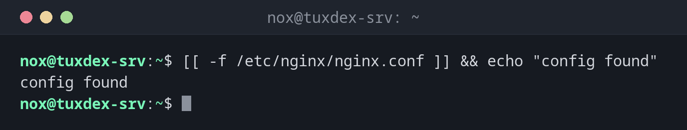

# test

> Checks a condition and returns exit code `0` (true) or `1` (false). Usually written as `[ … ]` or, in Bash, as `[[ … ]]`.



## Syntax

```bash
[[ EXPRESSION ]]
[ EXPRESSION ]
test EXPRESSION
```

`[[ ]]` is the Bash version: no word splitting problems, patterns and `&&` inside the brackets. Use it in Bash scripts. The spaces after `[[` and before `]]` are required.

## Options

| Expression | True if |
|------------|---------|
| `-f FILE` | The file exists and is a regular file |
| `-d DIR` | The directory exists |
| `-e PATH` | The path exists |
| `-x FILE` | The file is executable |
| `-z "$VAR"`, `-n "$VAR"` | The string is empty, not empty |
| `"$a" == "$b"`, `!=` | Strings are equal, different |
| `$a -eq $b`, `-ne`, `-lt`, `-gt`, `-le`, `-ge` | Number comparisons |
| `[[ $a == pat* ]]` | Pattern match (only `[[ ]]`) |
| `!`, `&&`, `\|\|` | Not, and, or |

## Examples

**Check whether a file exists:**

```bash
[[ -f /etc/nginx/nginx.conf ]] && echo "config found"
```

```text
config found
```

**Create a directory if it is missing:**

```bash
[[ -d /mnt/backup/daily ]] || mkdir -p /mnt/backup/daily
ls -d /mnt/backup/daily
```

```text
/mnt/backup/daily
```

**Compare with a pattern:**

```bash
host=web01
[[ $host == web* ]] && echo "$host is a web server"
```

```text
web01 is a web server
```

**The exit code of a false condition:**

```bash
[[ "a" == "b" ]]; echo $?
```

```text
1
```

**A classic mistake with `[`:**

```bash
count=""
[ $count -gt 0 ]
```

```text
bash: [: -gt: unary operator expected
```

The empty variable disappears and `[` sees only `-gt 0`. With `[[ ]]` or quotes, this can't
happen.

## When do I need it?

- Before using a file or directory: does it exist?
- To check arguments and variables at the start of a script
- Together with [`if`](if.md), `&&` and `||`

!!! tip "Use `-eq` for numbers"
    `==` compares strings: `[[ 10 == 10.0 ]]` is false. For numbers, use `-eq`, `-lt` and
    friends, or arithmetic with `(( a < b ))`.

!!! warning "Spaces are required"
    `[[$x == 1]]` fails with `command not found`. Brackets and operators must be separated by
    spaces: `[[ $x == 1 ]]`.

## Related commands

[if](if.md) · [case](case.md) · [while](while.md) · [shellcheck](shellcheck.md)
