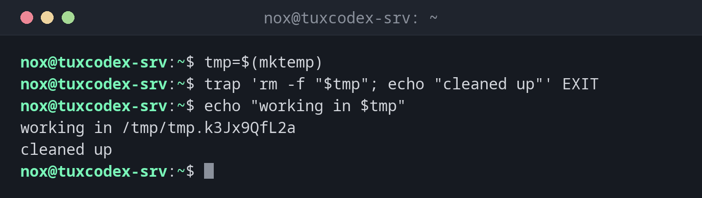

# trap

> Runs a command when the script ends or receives a signal. For cleaning up temporary files and releasing locks, also after errors and ++ctrl+c++.



## Syntax

```bash
trap 'COMMANDS' SIGNAL...
```

## Options

| Signal | When |
|--------|------|
| `EXIT` | Whenever the script ends, successfully or not |
| `ERR` | When a command fails (with `set -e`) |
| `INT` | ++ctrl+c++ |
| `TERM` | `kill` or `systemctl stop` |
| `trap - SIGNAL` | Remove the trap |
| `trap -p` | Show the active traps |

## Examples

**Delete a temporary file at the end:**

```bash
tmp=$(mktemp)
trap 'rm -f "$tmp"; echo "cleaned up"' EXIT
echo "working in $tmp"
```

```text
working in /tmp/tmp.k3Jx9QfL2a
cleaned up
```

**React to ++ctrl+c++:**

```bash
trap 'echo "interrupted, stopping"; exit 130' INT
sleep 60
```

```text
^Cinterrupted, stopping
```

**Restart a service even if the script fails:**

```bash
systemctl stop php8.4-fpm
trap 'systemctl start php8.4-fpm' EXIT
/usr/local/bin/migrate.sh
```

```text
migrate.sh: column "email" already exists
```

The migration failed, but the trap starts PHP-FPM again, and the shop keeps running.

## When do I need it?

- To delete temporary files, no matter how the script ends
- To release locks or restart a service that the script had stopped
- To report errors with the line number

!!! tip "`EXIT` is enough for cleaning up"
    A trap on `EXIT` also runs after errors with `set -e` and after `exit`. One trap covers all
    ways the script can end.

!!! tip "Find the line of an error"
    `trap 'echo "error in line $LINENO" >&2' ERR` reports where a script failed.

## Related commands

[set](set.md) · [exit](exit.md) · [kill](../08-processes/kill.md) · [flock](../16-scheduling/flock.md)
