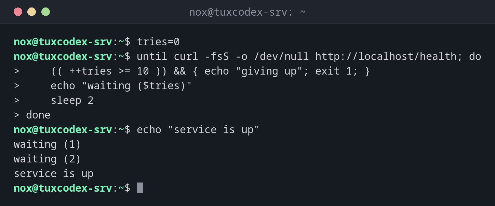

# while

> Wiederholt Befehle, solange eine Bedingung wahr ist. Außerdem der Standardweg, eine Datei Zeile für Zeile zu lesen.



## Syntax

```bash
while BEFEHL; do
    …
done
```

## Optionen

| Form | Bedeutung |
|------|-----------|
| `while BEFEHL` | Wiederholen, solange der Befehl mit `0` endet |
| `until BEFEHL` | Wiederholen, solange der Befehl scheitert |
| `while read -r zeile; do … done < DATEI` | Eine Datei Zeile für Zeile verarbeiten |
| `while true` | Endlosschleife, mit `break` beenden |
| `break`, `continue` | Die Schleife verlassen, die nächste Runde starten |

## Beispiele

**Warten, bis ein Dienst antwortet:**

```bash
tries=0
until curl -fsS -o /dev/null http://localhost/health; do
    (( ++tries >= 10 )) && { echo "giving up"; exit 1; }
    echo "waiting ($tries)"
    sleep 2
done
echo "service is up"
```

```text
waiting (1)
waiting (2)
service is up
```

**Eine Liste von Servern lesen:**

```bash
while read -r name ip; do
    echo "$name -> $ip"
done < hosts.txt
```

```text
web01 -> 192.0.2.10
web02 -> 192.0.2.11
```

**Herunterzählen:**

```bash
n=3
while (( n > 0 )); do
    echo "$n"
    (( n-- ))
done
```

```text
3
2
1
```

## Wann brauche ich das?

- Um zu warten, bis etwas bereit ist, etwa ein Dienst nach einem Neustart
- Um Dateien und Befehlsausgaben Zeile für Zeile zu lesen
- Für Wiederholungsversuche mit Obergrenze

!!! tip "Immer eine Grenze"
    Eine Schleife, die auf einen Dienst wartet, sollte irgendwann aufgeben. Zähle die Versuche
    und beende mit `break` oder `exit` nach einer sinnvollen Anzahl.

!!! warning "Pipes starten eine Subshell"
    Bei `befehl | while read …` läuft die Schleife in einer Subshell. Darin gesetzte Variablen
    sind danach weg. Nimm stattdessen `done < <(befehl)`.

## Verwandte Befehle

[for](for.md) · [read](read.md) · [test](test.md) · [getopts](getopts.md)
