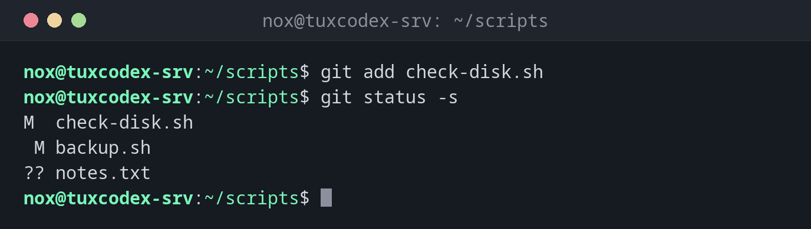

# git add

> Marks changes for the next commit by putting them into the staging area.



## Syntax

```bash
git add [OPTIONS] PATH...
```

## Options

| Option | Description |
|--------|-------------|
| `PATH` | File or directory; `.` means everything in the current directory and below |
| `-A`, `--all` | All changes in the whole repository, including deleted files |
| `-u`, `--update` | Only files Git already tracks, no new files |
| `-p`, `--patch` | Choose part by part which changes to add |
| `-n`, `--dry-run` | Only show what would be added |
| `-f`, `--force` | Also add a file excluded by `.gitignore` |

## Examples

**Add one file and check the result:**

```bash
git add check-disk.sh
git status -s
```

```text
M  check-disk.sh
 M backup.sh
?? notes.txt
```

`check-disk.sh` is now staged (left column), `backup.sh` is changed but not staged.

**See what git add . would do:**

```bash
git add -n .
```

```text
add 'backup.sh'
add 'notes.txt'
```

**Add only part of the changes:**

```bash
git add -p backup.sh
```

```text
diff --git a/backup.sh b/backup.sh
index 8791eb2..895c5d1 100644
--- a/backup.sh
+++ b/backup.sh
@@ -1,3 +1,4 @@
 #!/usr/bin/env bash
 set -euo pipefail
 nice -n 10 tar --zstd -cf "/mnt/backup/www-$(date +%F).tar.zst" -C /srv www
+echo "backup done"
(1/1) Stage this hunk [y,n,q,a,d,e,p,?]? y
```

**Add all changes to tracked files:**

```bash
git add -u
git status -s
```

```text
M  backup.sh
M  check-disk.sh
?? notes.txt
```

## When do I need it?

- Before every commit, to decide exactly what goes into it
- To split several changes in one file into separate commits with `-p`
- To add new files to the repository

!!! tip "Clean commits with -p"
    `git add -p` shows every changed block and asks `y` (add) or `n` (skip). That way a
    commit only contains what belongs together.

!!! warning "Check before git add ."
    `git add .` also adds new files you might not want in the repository, such as log
    files or a `.env` with passwords. Look at `git status` first, or use `-n`.

## Related commands

[git status](git-status.md) · [git commit](git-commit.md) · [git restore](git-restore.md) · [git diff](git-diff.md)
