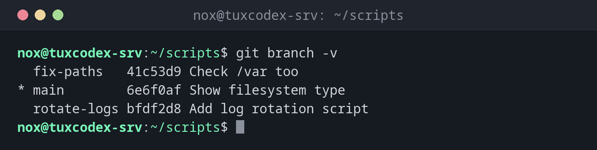

# git branch

> Listet Branches auf, legt sie an, benennt sie um und löscht sie.



## Syntax

```bash
git branch [OPTIONEN] [NAME [START]]
```

## Optionen

| Option | Beschreibung |
|--------|--------------|
| (keine) | Die lokalen Branches auflisten, `*` markiert den aktuellen |
| `NAME` | Einen neuen Branch anlegen (ohne zu ihm zu wechseln) |
| `-v`, `-vv` | Auch den letzten Commit zeigen; mit `-vv` zusätzlich den Branch auf dem Server |
| `-a`, `--all` | Auch die Branches auf dem Server auflisten (`remotes/origin/…`) |
| `-d NAME` | Einen zusammengeführten Branch löschen |
| `-D NAME` | Einen Branch löschen, auch wenn er nicht zusammengeführt ist |
| `-m ALT NEU` | Einen Branch umbenennen |
| `--merged`, `--no-merged` | Nur Branches, die in den aktuellen (nicht) zusammengeführt sind |

## Beispiele

**Die Branches mit ihrem letzten Commit auflisten:**

```bash
git branch -v
```

```text
  fix-paths   41c53d9 Check /var too
* main        6e6f0af Show filesystem type
  rotate-logs bfdf2d8 Add log rotation script
```

**Lokale Branches und Branches auf dem Server:**

```bash
git branch -a
```

```text
* main
  remotes/origin/main
  remotes/origin/nginx-tls
```

**Anzeigen, welchem Server-Branch jeder Branch folgt:**

```bash
git branch -vv
```

```text
* main      5f9cfee [origin/main: behind 1] Check /var too
  nginx-tls d5bb689 [origin/nginx-tls] Add TLS check
```

**Einen zusammengeführten Branch löschen:**

```bash
git branch -d rotate-logs
```

```text
Deleted branch rotate-logs (was bfdf2d8).
```

**Git schützt Branches, die nicht zusammengeführt sind:**

```bash
git branch -d fix-paths
```

```text
error: the branch 'fix-paths' is not fully merged
hint: If you are sure you want to delete it, run 'git branch -D fix-paths'
hint: Disable this message with "git config advice.forceDeleteBranch false"
```

## Wann brauche ich das?

- Um eine Änderung auszuprobieren, ohne den funktionierenden Stand auf `main` anzufassen
- Um einen Überblick über offene Arbeit und den Stand auf dem Server zu bekommen
- Um fertige, zusammengeführte Branches aufzuräumen

!!! tip "Namen, die etwas sagen"
    Benenne Branches nach dem, was sie ändern: `nginx-tls`, `fix-backup-path`. Dann ist
    `git branch` allein schon eine kleine Aufgabenliste.

!!! warning "-D wirft Commits weg"
    `git branch -D` löscht auch Commits, die auf keinem anderen Branch liegen. Eine Weile
    findest du sie noch mit `git reflog`, verlassen solltest du dich darauf aber nicht.

## Verwandte Befehle

[git switch](git-switch.md) · [git merge](git-merge.md) · [git rebase](git-rebase.md) · [git push](git-push.md)
