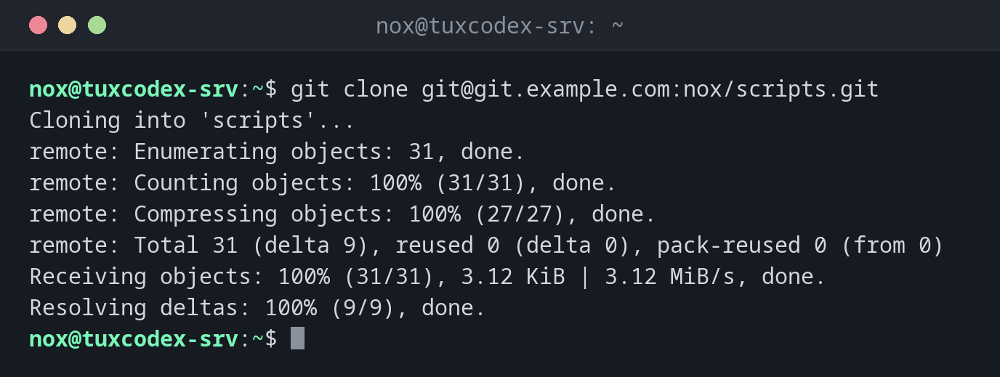

# git clone

> Kopiert ein bestehendes Repository samt vollständigem Verlauf von einem Server oder aus einem anderen Verzeichnis.



## Syntax

```bash
git clone [OPTIONEN] URL [VERZEICHNIS]
```

## Optionen

| Option | Beschreibung |
|--------|--------------|
| `VERZEICHNIS` | Zielverzeichnis, sonst der Name des Repositorys |
| `-b NAME`, `--branch NAME` | Diesen Branch oder Tag statt des Standard-Branches auschecken |
| `--depth N` | Nur die letzten N Commits holen (Shallow Clone) |
| `--single-branch` | Nur einen Branch holen |
| `--bare` | Kopie ohne Arbeitsverzeichnis, etwa um ein Repository auf einen anderen Server umzuziehen |
| `-q`, `--quiet` | Keine Fortschrittsanzeige |

## Beispiele

**Ein Repository per SSH klonen:**

```bash
git clone git@git.example.com:nox/scripts.git
```

```text
Cloning into 'scripts'...
remote: Enumerating objects: 31, done.
remote: Counting objects: 100% (31/31), done.
remote: Compressing objects: 100% (27/27), done.
remote: Total 31 (delta 9), reused 0 (delta 0), pack-reused 0 (from 0)
Receiving objects: 100% (31/31), 3.12 KiB | 3.12 MiB/s, done.
Resolving deltas: 100% (9/9), done.
```

**In ein bestimmtes Verzeichnis klonen:**

```bash
sudo git clone -q git@git.example.com:nox/scripts.git /opt/scripts
ls /opt/scripts
```

```text
README.md  backup.sh  check-disk.sh  check-services.sh  rotate-logs.sh
```

**Nur den neuesten Stand, ohne den alten Verlauf:**

```bash
git clone --depth 1 https://git.example.com/nox/scripts.git
```

```text
Cloning into 'scripts'...
remote: Enumerating objects: 8, done.
remote: Counting objects: 100% (8/8), done.
remote: Compressing objects: 100% (6/6), done.
remote: Total 8 (delta 0), reused 0 (delta 0), pack-reused 0 (from 0)
Receiving objects: 100% (8/8), done.
```

**Eine bestimmte Version klonen:**

```bash
git clone -q -b v1.0 git@git.example.com:nox/scripts.git scripts-v1.0
git -C scripts-v1.0 log --oneline -1
```

```text
3fcc96a Also check /mnt/backup
```

## Wann brauche ich das?

- Um deine Skripte oder Konfiguration auf einen neuen Server zu bringen
- Um ein Werkzeug oder Ansible-Rollen von GitHub oder GitLab zu holen
- Um vom eigenen Rechner aus an einem Repository zu arbeiten

!!! tip "Deploy Keys für Server"
    Ein Server, der nur abholen soll, braucht nicht deinen persönlichen Schlüssel. GitHub
    und GitLab erlauben einen *Deploy Key* für ein einzelnes Repository, standardmäßig nur
    lesend.

!!! warning "Keine Passwörter über HTTPS"
    GitHub und viele GitLab-Instanzen akzeptieren für `git clone` über HTTPS nicht das
    Passwort deines Kontos. Nutze stattdessen SSH oder ein Access Token.

## Verwandte Befehle

[git init](git-init.md) · [git pull](git-pull.md) · [git remote](git-remote.md) · [ssh-keygen](../12-ssh/ssh-keygen.md)
