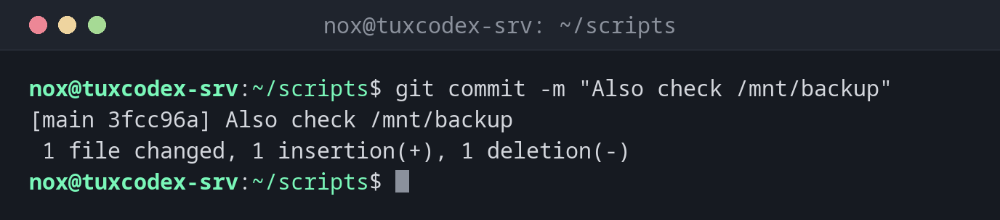

# git commit

> Saves the staged changes as a new commit in the history of the repository.



## Syntax

```bash
git commit [-a] [-m "MESSAGE"] [--amend]
```

## Options

| Option | Description |
|--------|-------------|
| `-m MESSAGE` | Commit message on the command line, otherwise the editor opens |
| `-a`, `--all` | Commit all changed tracked files, without `git add` first (no new files) |
| `--amend` | Replace the last commit, for example to add a forgotten file |
| `--no-edit` | With `--amend`: keep the message |
| `-v`, `--verbose` | Show the changes in the editor while you write the message |

## Examples

**Commit the staged changes:**

```bash
git commit -m "Also check /mnt/backup"
```

```text
[main 3fcc96a] Also check /mnt/backup
 1 file changed, 1 insertion(+), 1 deletion(-)
```

`3fcc96a` is the start of the commit's ID (hash), by which you can address it later.

**Add and commit all changed files in one step:**

```bash
git commit -am "Run backup with lower priority"
```

```text
[main c31bfe7] Run backup with lower priority
 1 file changed, 1 insertion(+), 1 deletion(-)
```

**Add a forgotten file to the last commit:**

```bash
git add check-services.sh
git commit --amend --no-edit
```

```text
[main a41c7e2] Add service check
 Date: Mon Oct 26 10:12:40 2026 +0100
 2 files changed, 4 insertions(+)
 create mode 100755 check-services.sh
```

**Write a longer message in the editor:**

```bash
git commit
```

```text

# Please enter the commit message for your changes. Lines starting
# with '#' will be ignored, and an empty message aborts the commit.
#
# On branch main
# Your branch is up to date with 'origin/main'.
#
# Changes to be committed:
#       modified:   check-disk.sh
#
```

Write the summary in the first line, leave the second line empty and add the details below. Save and close the editor to create the commit.

## When do I need it?

- After every logical change, such as a fixed bug or a new setting
- Before a risky change, so you have a state you can go back to
- To fix the last commit before you push it, with `--amend`

!!! tip "Small and often"
    One commit per change makes the history readable, and you can undo exactly one change
    later. A commit costs nothing.

!!! warning "--amend only before pushing"
    `--amend` creates a new commit and replaces the old one. If the old one is already on
    the server, your history no longer matches the server's and the next push is rejected.

## Related commands

[git add](git-add.md) · [git status](git-status.md) · [git log](git-log.md) · [git push](git-push.md)
