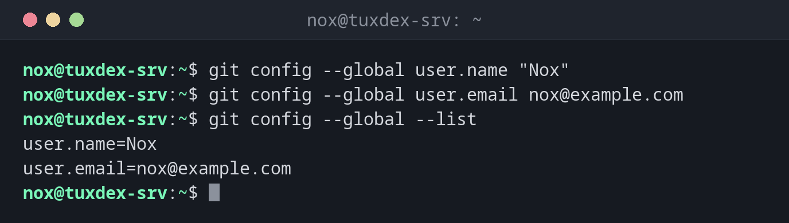

# git config

> Liest und setzt Git-Einstellungen, vor allem deinen Namen und deine E-Mail-Adresse für Commits.



## Syntax

```bash
git config [--global | --system | --local] NAME [WERT]
```

## Optionen

| Option | Beschreibung |
|--------|--------------|
| `--global` | Einstellung für deinen Benutzer, gespeichert in `~/.gitconfig` |
| `--system` | Einstellung für alle Benutzer, gespeichert in `/etc/gitconfig` |
| `--local` | Einstellung nur für das aktuelle Repository, gespeichert in `.git/config` (Standard beim Schreiben) |
| `--list`, `-l` | Alle Einstellungen anzeigen |
| `--show-origin` | Zu jeder Einstellung die Datei anzeigen, aus der sie stammt |
| `--get NAME` | Eine einzelne Einstellung anzeigen (wie `git config NAME`) |
| `--unset NAME` | Eine Einstellung entfernen |
| `--edit`, `-e` | Die Konfigurationsdatei im Editor öffnen |

## Beispiele

**Namen und E-Mail-Adresse setzen:**

```bash
git config --global user.name "Nox"
git config --global user.email nox@example.com
git config --global --list
```

```text
user.name=Nox
user.email=nox@example.com
```

**Sehen, woher jede Einstellung stammt:**

```bash
git config --list --show-origin
```

```text
file:/home/nox/.gitconfig     user.name=Nox
file:/home/nox/.gitconfig     user.email=nox@example.com
file:/home/nox/.gitconfig     init.defaultbranch=main
file:/home/nox/.gitconfig     core.editor=vim
file:.git/config              core.repositoryformatversion=0
file:.git/config              remote.origin.url=git@git.example.com:nox/scripts.git
```

**In einem Repository eine andere Adresse nutzen:**

```bash
git config user.email ops@example.com
git config user.email
```

```text
ops@example.com
```

Ohne `--global` gilt die Einstellung nur für das aktuelle Repository und hat dort Vorrang vor der globalen.

**Eine Abkürzung für einen kompakten Verlauf anlegen:**

```bash
git config --global alias.lg "log --oneline --graph --all"
git lg -3
```

```text
* fcdca2b (HEAD -> main, origin/main) Add service check
* 5f9cfee Check /var too
* 6e6f0af Show filesystem type
```

**Was ohne Namen und Adresse passiert:**

```bash
git commit -m "Add backup script"
```

```text
Author identity unknown

*** Please tell me who you are.

Run

  git config --global user.email "you@example.com"
  git config --global user.name "Your Name"

to set your account's default identity.
Omit --global to set the identity only in this repository.

fatal: unable to auto-detect email address (got 'nox@tuxdex-srv.(none)')
```

## Wann brauche ich das?

- Einmal auf jedem neuen Server oder Konto, vor dem ersten Commit
- Um in einem einzelnen Repository eine andere E-Mail-Adresse zu nutzen
- Um den Editor für Commit-Nachrichten festzulegen und Abkürzungen (Aliase) anzulegen

!!! tip "Den Editor wählen"
    Ohne Einstellung öffnet Git den Editor aus `$EDITOR`, oft `vi`. Lieber nano:
    `git config --global core.editor nano`.

## Verwandte Befehle

[git init](git-init.md) · [git commit](git-commit.md) · [ssh-keygen](../12-ssh/ssh-keygen.md)
