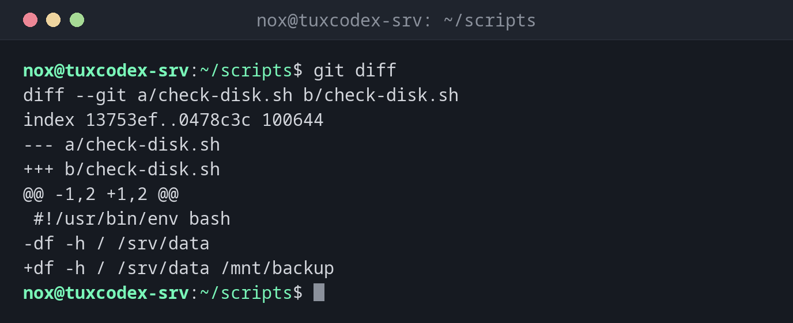

# git diff

> Zeigt Zeile für Zeile, was sich geändert hat: im Arbeitsverzeichnis, im Staging-Bereich oder zwischen zwei Commits.



## Syntax

```bash
git diff [OPTIONEN] [COMMIT [COMMIT]] [-- PFAD...]
```

## Optionen

| Option | Beschreibung |
|--------|--------------|
| (keine) | Arbeitsverzeichnis gegen Staging-Bereich: Änderungen, die noch nicht hinzugefügt sind |
| `--staged`, `--cached` | Staging-Bereich gegen letzten Commit: was der nächste Commit enthält |
| `HEAD` | Alle Änderungen seit dem letzten Commit, vorgemerkt oder nicht |
| `COMMIT1 COMMIT2` | Unterschiede zwischen zwei Commits, Branches oder Tags |
| `--stat` | Nur eine Zusammenfassung pro Datei |
| `--name-only` | Nur die Namen der geänderten Dateien |
| `--word-diff` | Geänderte Wörter statt ganzer Zeilen markieren |

## Beispiele

**Noch nicht hinzugefügte Änderungen zeigen:**

```bash
git diff
```

```text
diff --git a/check-disk.sh b/check-disk.sh
index 13753ef..0478c3c 100644
--- a/check-disk.sh
+++ b/check-disk.sh
@@ -1,2 +1,2 @@
 #!/usr/bin/env bash
-df -h / /srv/data
+df -h / /srv/data /mnt/backup
```

Zeilen mit `-` wurden entfernt, Zeilen mit `+` hinzugefügt. `@@ -1,2 +1,2 @@` gibt an, welche Zeilen der alten und neuen Version zu sehen sind.

**Was der nächste Commit enthält:**

```bash
git diff --staged --stat
```

```text
 check-disk.sh | 2 +-
 1 file changed, 1 insertion(+), 1 deletion(-)
```

**Änderungen seit einer Version:**

```bash
git diff v1.0 HEAD --stat
```

```text
 backup.sh         | 2 +-
 check-disk.sh     | 2 +-
 check-services.sh | 2 ++
 rotate-logs.sh    | 2 ++
 4 files changed, 6 insertions(+), 2 deletions(-)
```

**Nur die geänderten Wörter markieren:**

```bash
git diff --word-diff
```

```text
diff --git a/check-disk.sh b/check-disk.sh
index f12cb8f..fe28cce 100644
--- a/check-disk.sh
+++ b/check-disk.sh
@@ -1,2 +1,2 @@
#!/usr/bin/env bash
df [--hT-]{+-h+} / /srv/data /mnt/backup /var
```

## Wann brauche ich das?

- Vor jedem Commit, um genau zu prüfen, was du geändert hast
- Um zu sehen, was sich zwischen der ausgerollten und der aktuellen Version geändert hat
- Um die eine geänderte Einstellung in einer langen Konfigurationsdatei zu finden

!!! tip "Leer nach git add?"
    Nach `git add` zeigt `git diff` ohne Optionen für diese Datei nichts mehr, weil
    Arbeitsverzeichnis und Staging-Bereich wieder gleich sind. Nimm `git diff --staged`.

## Verwandte Befehle

[git status](git-status.md) · [git add](git-add.md) · [git log](git-log.md) · [diff](../05-text-processing/diff.md)
