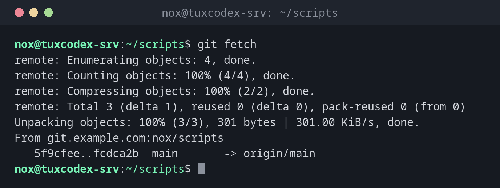

# git fetch

> Lädt neue Commits vom Server herunter, ohne deine Dateien oder Branches zu ändern.



## Syntax

```bash
git fetch [OPTIONEN] [REMOTE]
```

## Optionen

| Option | Beschreibung |
|--------|--------------|
| `REMOTE` | Von diesem Remote holen, standardmäßig `origin` |
| `--all` | Von allen Remotes holen |
| `-p`, `--prune` | Lokale Verweise auf Branches entfernen, die auf dem Server gelöscht wurden |
| `--tags` | Auch alle Tags holen |
| `--dry-run` | Nur anzeigen, was geholt würde |

## Beispiele

**Neue Commits holen:**

```bash
git fetch
```

```text
remote: Enumerating objects: 4, done.
remote: Counting objects: 100% (4/4), done.
remote: Compressing objects: 100% (2/2), done.
remote: Total 3 (delta 1), reused 0 (delta 0), pack-reused 0 (from 0)
Unpacking objects: 100% (3/3), 301 bytes | 301.00 KiB/s, done.
From git.example.com:nox/scripts
   5f9cfee..fcdca2b  main       -> origin/main
```

**Was auf dem Server neu ist:**

```bash
git status -sb
git log --oneline main..origin/main
```

```text
## main...origin/main [behind 1]
fcdca2b Add service check
```

`main..origin/main` heißt: Commits, die auf `origin/main` liegen, aber noch nicht auf `main`.

**Die Änderungen vor dem Übernehmen ansehen:**

```bash
git diff --stat main origin/main
```

```text
 check-services.sh | 2 ++
 1 file changed, 2 insertions(+)
```

**Auf dem Server gelöschte Branches entfernen:**

```bash
git fetch --prune
```

```text
From git.example.com:nox/scripts
 - [deleted]         (none)     -> origin/nginx-tls
```

## Wann brauche ich das?

- Um zu sehen, was sich auf dem Server geändert hat, bevor du es auf einen Produktivserver übernimmst
- Um zu prüfen, ob jemand im Team etwas Neues gepusht hat
- Um mit `--prune` Branches aufzuräumen, die auf dem Server gelöscht wurden

!!! tip "fetch ist immer sicher"
    `git fetch` aktualisiert nur `origin/main` und die anderen Server-Branches. Deine
    Branches und Dateien bleiben genau, wie sie sind: erst ansehen, dann entscheiden.

## Verwandte Befehle

[git pull](git-pull.md) · [git remote](git-remote.md) · [git log](git-log.md) · [git merge](git-merge.md)
