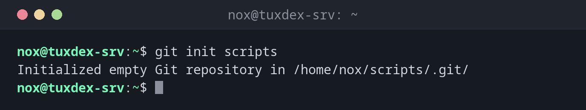

# git init

> Creates a new, empty Git repository in a directory.



## Syntax

```bash
git init [-b BRANCH] [--bare] [DIRECTORY]
```

## Options

| Option | Description |
|--------|-------------|
| `DIRECTORY` | Create the repository there (created if missing), otherwise in the current directory |
| `-b NAME`, `--initial-branch=NAME` | Name of the first branch, for example `main` |
| `--bare` | Repository without working directory, as a central repository on a server |
| `-q`, `--quiet` | No output |

## Examples

**Create a repository for your scripts:**

```bash
git init scripts
```

```text
Initialized empty Git repository in /home/nox/scripts/.git/
```

**Put an existing directory under version control:**

```bash
cd /etc/nginx
sudo git init
sudo git add .
sudo git commit -m "Initial nginx configuration"
```

```text
Initialized empty Git repository in /etc/nginx/.git/
[main (root-commit) 2b8e0d4] Initial nginx configuration
 14 files changed, 412 insertions(+)
 create mode 100644 conf.d/default.conf
 create mode 100644 fastcgi_params
 create mode 100644 mime.types
 create mode 100644 nginx.conf
 ...
```

**Choose the name of the first branch:**

```bash
git init -b main monitoring
```

```text
Initialized empty Git repository in /home/nox/monitoring/.git/
```

**A central repository on your own server:**

```bash
sudo git init --bare /srv/git/scripts.git
sudo chown -R nox: /srv/git/scripts.git
```

```text
Initialized empty Git repository in /srv/git/scripts.git/
```

Others clone it over SSH with `git clone nox@tuxdex-srv:/srv/git/scripts.git`.

## When do I need it?

- To start a new collection of scripts with version history
- To put an existing configuration directory like `/etc/nginx` under version control
- To set up a central repository on your own server that others clone over SSH

!!! tip "Name of the first branch"
    If `init.defaultBranch` isn't set, Git calls the first branch `master` and prints a
    long hint. Set `git config --global init.defaultBranch main` once, or use `-b main`.

!!! warning "Protect .git in system directories"
    The `.git` directory contains every old version of every file, including files whose
    permissions you later restricted. In `/etc` and similar places, make it readable for
    root only: `sudo chmod 700 /etc/nginx/.git`.

## Related commands

[git clone](git-clone.md) · [git config](git-config.md) · [git status](git-status.md) · [git remote](git-remote.md)
