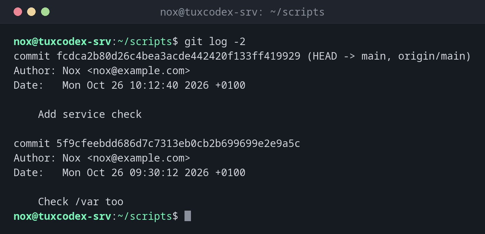

# git log

> Shows the history of commits: who changed what, when and why.



## Syntax

```bash
git log [OPTIONS] [RANGE] [-- PATH...]
```

## Options

| Option | Description |
|--------|-------------|
| `--oneline` | One line per commit: short ID and message |
| `-N`, `-n N` | Only the last N commits |
| `--graph` | Draw branches and merges as a graph |
| `--all` | All branches, not only the current one |
| `-p`, `--patch` | Show the changes of each commit |
| `--stat` | Show the changed files of each commit |
| `--since=DATE`, `--until=DATE` | Only commits in this time range, such as `2026-10-24` or `"2 weeks ago"` |
| `--author=NAME` | Only commits by this author |
| `--grep=TEXT` | Only commits whose message contains the text |
| `-- PATH` | Only commits that changed this file or directory |

## Examples

**Show the last commits:**

```bash
git log -2
```

```text
commit fcdca2b80d26c4bea3acde442420f133ff419929 (HEAD -> main, origin/main)
Author: Nox <nox@example.com>
Date:   Mon Oct 26 10:12:40 2026 +0100

    Add service check

commit 5f9cfeebdd686d7c7313eb0cb2b699699e2e9a5c
Author: Nox <nox@example.com>
Date:   Mon Oct 26 09:30:12 2026 +0100

    Check /var too
```

**Compact history with branches:**

```bash
git log --oneline --graph --all
```

```text
* fcdca2b (HEAD -> main, origin/main) Add service check
* 5f9cfee Check /var too
* 6e6f0af Show filesystem type
*   bdb6db4 Merge branch rotate-logs
|\
| * bfdf2d8 Add log rotation script
* | c31bfe7 Run backup with lower priority
|/
* 3fcc96a (tag: v1.0) Also check /mnt/backup
* 7f4bd56 Add README
* 0487470 Add backup and disk check scripts
```

**The last change to a file, with the diff:**

```bash
git log -p -1 check-disk.sh
```

```text
commit 5f9cfeebdd686d7c7313eb0cb2b699699e2e9a5c
Author: Nox <nox@example.com>
Date:   Mon Oct 26 09:30:12 2026 +0100

    Check /var too

diff --git a/check-disk.sh b/check-disk.sh
index 58ebc04..f12cb8f 100644
--- a/check-disk.sh
+++ b/check-disk.sh
@@ -1,2 +1,2 @@
 #!/usr/bin/env bash
-df -hT / /srv/data /mnt/backup
+df -hT / /srv/data /mnt/backup /var
```

**Commits since a date:**

```bash
git log --oneline --since=2026-10-24
```

```text
fcdca2b Add service check
5f9cfee Check /var too
6e6f0af Show filesystem type
bdb6db4 Merge branch rotate-logs
c31bfe7 Run backup with lower priority
```

**Search the commit messages:**

```bash
git log --oneline --grep=backup
```

```text
c31bfe7 Run backup with lower priority
3fcc96a Also check /mnt/backup
0487470 Add backup and disk check scripts
```

## When do I need it?

- To find out when and why a configuration was changed
- To narrow down when a problem started: which commits came after the last working state?
- To see what a colleague changed on a shared repository

!!! tip "Leave the pager with q"
    Long output opens in a pager like `less`. Scroll with the arrow keys, search with `/`,
    quit with `q`.

## Related commands

[git diff](git-diff.md) · [git tag](git-tag.md) · [git commit](git-commit.md) · [git branch](git-branch.md)
