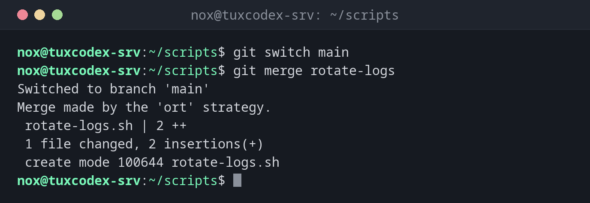

# git merge

> Merges the changes of another branch into the current branch.



## Syntax

```bash
git merge [OPTIONS] BRANCH
```

## Options

| Option | Description |
|--------|-------------|
| `BRANCH` | The branch whose commits are merged into the current one |
| `--ff-only` | Only merge if no merge commit is needed (fast-forward), otherwise abort |
| `--no-ff` | Always create a merge commit, even if a fast-forward would be possible |
| `--squash` | Combine all changes of the branch into a single new commit |
| `-m MESSAGE` | Message of the merge commit |
| `--abort` | Cancel a merge with conflicts and restore the previous state |

## Examples

**Merge a finished branch into main:**

```bash
git switch main
git merge rotate-logs
```

```text
Switched to branch 'main'
Merge made by the 'ort' strategy.
 rotate-logs.sh | 2 ++
 1 file changed, 2 insertions(+)
 create mode 100644 rotate-logs.sh
```

**A fast-forward without merge commit:**

```bash
git merge fix-paths
```

```text
Updating 6e6f0af..5f9cfee
Fast-forward
 check-disk.sh | 2 +-
 1 file changed, 1 insertion(+), 1 deletion(-)
```

**A conflict: both branches changed the same line:**

```bash
git merge fix-paths
cat check-disk.sh
```

```text
Auto-merging check-disk.sh
CONFLICT (content): Merge conflict in check-disk.sh
Automatic merge failed; fix conflicts and then commit the result.
#!/usr/bin/env bash
<<<<<<< HEAD
df -hT / /srv/data /mnt/backup
=======
df -h / /srv/data /mnt/backup /var
>>>>>>> fix-paths
```

Above `=======` is the version of the current branch, below it the one from `fix-paths`. Edit the file so that only the right line remains, without the markers.

**Complete the merge after resolving the conflict:**

```bash
git add check-disk.sh
git commit --no-edit
```

```text
[main 8d2f6a1] Merge branch 'fix-paths'
```

**Cancel the merge instead:**

```bash
git merge --abort
git status
```

```text
On branch main
Your branch is up to date with 'origin/main'.

nothing to commit, working tree clean
```

## When do I need it?

- When a change on its own branch is finished and tested
- To bring changes from the server into your branch (that's what `git pull` does)

!!! tip "Fast-forward or merge commit"
    If `main` hasn't moved on since the branch was created, Git simply moves `main`
    forward (fast-forward). Otherwise it creates a merge commit with two parents.

!!! warning "Remove all conflict markers"
    Git doesn't check whether `<<<<<<<`, `=======` and `>>>>>>>` are still in the file.
    A configuration file with these lines breaks the service. Check with
    `grep -n '^<<<<<<<' FILE` before you commit.

## Related commands

[git branch](git-branch.md) · [git switch](git-switch.md) · [git rebase](git-rebase.md) · [git pull](git-pull.md)
