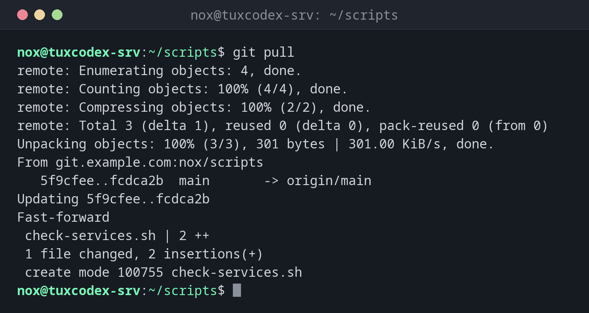

# git pull

> Fetches new commits from the server and merges them into the current branch.



## Syntax

```bash
git pull [--ff-only | --rebase] [REMOTE [BRANCH]]
```

## Options

| Option | Description |
|--------|-------------|
| `--ff-only` | Only update if no merge is needed, otherwise abort |
| `--rebase` | Put your own commits on top of the new ones instead of merging |
| `--no-rebase` | Merge, creating a merge commit if needed |
| `--autostash` | Put local changes aside before and restore them afterwards |
| `-q`, `--quiet` | No output |

## Examples

**Get the latest state:**

```bash
git pull
```

```text
remote: Enumerating objects: 4, done.
remote: Counting objects: 100% (4/4), done.
remote: Compressing objects: 100% (2/2), done.
remote: Total 3 (delta 1), reused 0 (delta 0), pack-reused 0 (from 0)
Unpacking objects: 100% (3/3), 301 bytes | 301.00 KiB/s, done.
From git.example.com:nox/scripts
   5f9cfee..fcdca2b  main       -> origin/main
Updating 5f9cfee..fcdca2b
Fast-forward
 check-services.sh | 2 ++
 1 file changed, 2 insertions(+)
 create mode 100755 check-services.sh
```

**Nothing new:**

```bash
git pull
```

```text
Already up to date.
```

**Update a server safely:**

```bash
cd /opt/scripts
sudo git pull --ff-only -q
git log --oneline -1
```

```text
fcdca2b Add service check
```

**Both sides have new commits:**

```bash
git pull
```

```text
From git.example.com:nox/scripts
   fcdca2b..b9d2121  main       -> origin/main
hint: You have divergent branches and need to specify how to reconcile them.
hint: You can do so by running one of the following commands sometime before
hint: your next pull:
hint:
hint:   git config pull.rebase false  # merge
hint:   git config pull.rebase true   # rebase
hint:   git config pull.ff only       # fast-forward only
hint:
hint: You can replace "git config" with "git config --global" to set a default
hint: preference for all repositories. You can also pass --rebase, --no-rebase,
hint: or --ff-only on the command line to override the configured default per
hint: invocation.
fatal: Need to specify how to reconcile divergent branches.
```

**Put your own commit on top of the new ones:**

```bash
git pull --rebase
git log --oneline -3
```

```text
Successfully rebased and updated refs/heads/main.
599c398 Rotate logs after 14 days
b9d2121 Document check scripts
fcdca2b Add service check
```

## When do I need it?

- Before you start working, to get the latest state
- To update scripts or configuration on a server from the repository
- In a deployment script or cron job that keeps a directory up to date

!!! tip "--ff-only on servers"
    On a server that only receives changes, `git pull --ff-only` is the safe choice: it
    either updates cleanly or stops, but never creates a merge commit. Set it permanently
    with `git config pull.ff only`.

!!! warning "Local changes on the server"
    If someone edited a versioned file directly on the server, `git pull` stops with
    `Your local changes ... would be overwritten`. Check with `git diff` what was changed
    before you discard or commit it.

## Related commands

[git fetch](git-fetch.md) · [git merge](git-merge.md) · [git rebase](git-rebase.md) · [git push](git-push.md)
