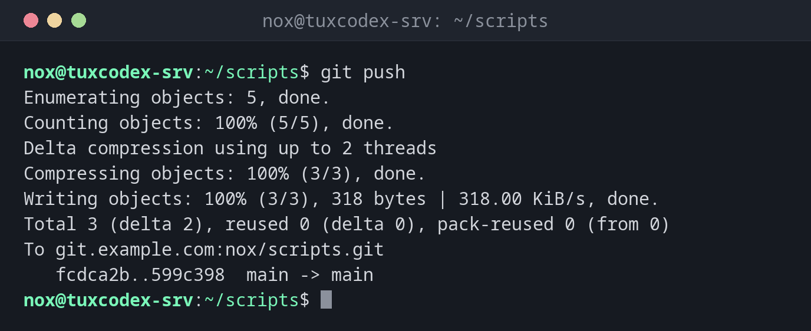

# git push

> Sends your local commits to the server.



## Syntax

```bash
git push [-u] [REMOTE [BRANCH]]
```

## Options

| Option | Description |
|--------|-------------|
| `-u`, `--set-upstream` | Remember the server branch, so that later a plain `git push` and `git pull` are enough |
| `--follow-tags` | Also send annotated tags that belong to the pushed commits |
| `--tags` | Send all tags |
| `-d`, `--delete BRANCH` | Delete a branch on the server |
| `--force-with-lease` | Overwrite the server branch, but only if nobody else pushed in the meantime |
| `-n`, `--dry-run` | Only show what would be sent |

## Examples

**Send new commits to the server:**

```bash
git push
```

```text
Enumerating objects: 5, done.
Counting objects: 100% (5/5), done.
Delta compression using up to 2 threads
Compressing objects: 100% (3/3), done.
Writing objects: 100% (3/3), 318 bytes | 318.00 KiB/s, done.
Total 3 (delta 2), reused 0 (delta 0), pack-reused 0 (from 0)
To git.example.com:nox/scripts.git
   fcdca2b..599c398  main -> main
```

**Publish a new branch:**

```bash
git push -u origin nginx-tls
```

```text
Enumerating objects: 4, done.
Counting objects: 100% (4/4), done.
Delta compression using up to 2 threads
Compressing objects: 100% (2/2), done.
Writing objects: 100% (3/3), 297 bytes | 297.00 KiB/s, done.
Total 3 (delta 1), reused 0 (delta 0), pack-reused 0 (from 0)
remote:
remote: To create a merge request for nginx-tls, visit:
remote:   https://git.example.com/nox/scripts/-/merge_requests/new?merge_request%5Bsource_branch%5D=nginx-tls
remote:
To git.example.com:nox/scripts.git
 * [new branch]      nginx-tls -> nginx-tls
branch 'nginx-tls' set up to track 'origin/nginx-tls'.
```

The `remote:` lines come from the server, here a GitLab instance.

**The server has newer commits:**

```bash
git push
```

```text
To git.example.com:nox/scripts.git
 ! [rejected]        main -> main (fetch first)
error: failed to push some refs to 'git.example.com:nox/scripts.git'
hint: Updates were rejected because the remote contains work that you do not
hint: have locally. This is usually caused by another repository pushing to
hint: the same ref. If you want to integrate the remote changes, use
hint: 'git pull' before pushing again.
hint: See the 'Note about fast-forwards' in 'git push --help' for details.
```

**Delete a branch on the server:**

```bash
git push origin --delete nginx-tls
```

```text
To git.example.com:nox/scripts.git
 - [deleted]         nginx-tls
```

## When do I need it?

- After committing, so that the changes are safe on the server and others can get them
- To publish a new branch, for example for a merge request
- To clean up branches on the server that are no longer needed

!!! tip "Rejected? Pull first"
    If the server has commits you don't have yet, Git refuses the push. Run `git pull`
    (or `git pull --rebase`) and push again.

!!! danger "Don't use --force"
    `git push --force` overwrites the branch on the server and deletes commits that others
    pushed. If you really have to overwrite, use `--force-with-lease`: it refuses if the
    server has changed since your last fetch.

## Related commands

[git pull](git-pull.md) · [git remote](git-remote.md) · [git commit](git-commit.md) · [git tag](git-tag.md)
