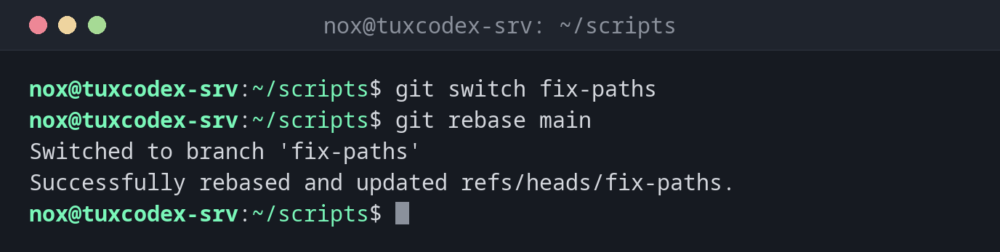

# git rebase

> Setzt die Commits eines Branches auf den neuesten Stand eines anderen Branches, als hättest du erst jetzt angefangen.



## Syntax

```bash
git rebase [OPTIONEN] [BRANCH]
```

## Optionen

| Option | Beschreibung |
|--------|--------------|
| `BRANCH` | Die Commits des aktuellen Branches oben auf diesen Branch setzen |
| `-i`, `--interactive` | Die Liste der Commits vorher bearbeiten: umsortieren, zusammenfassen, umbenennen oder weglassen |
| `--continue` | Nach dem Lösen eines Konflikts weitermachen |
| `--skip` | Den Commit, der den Konflikt verursacht, auslassen |
| `--abort` | Abbrechen und den Stand vor dem Rebase wiederherstellen |

## Beispiele

**Einen Branch auf den Stand von main bringen:**

```bash
git switch fix-paths
git rebase main
```

```text
Switched to branch 'fix-paths'
Successfully rebased and updated refs/heads/fix-paths.
```

**Der Verlauf vorher und nachher:**

```bash
git log --oneline --graph main fix-paths
```

```text
* 5f9cfee (HEAD -> fix-paths) Check /var too
* 6e6f0af (main) Show filesystem type
*   bdb6db4 Merge branch rotate-logs
```

Vor dem Rebase zweigte `fix-paths` bei `bdb6db4` ab. Jetzt liegt sein Commit mit neuer ID oben auf `main`, und `git merge fix-paths` auf `main` wird ein einfacher Fast-Forward.

**Ein Konflikt während des Rebase:**

```bash
git rebase main
```

```text
Auto-merging check-disk.sh
CONFLICT (content): Merge conflict in check-disk.sh
error: could not apply 41c53d9... Check /var too
hint: Resolve all conflicts manually, mark them as resolved with
hint: "git add/rm <conflicted_files>", then run "git rebase --continue".
hint: You can instead skip this commit: run "git rebase --skip".
hint: To abort and get back to the state before "git rebase", run "git rebase --abort".
hint: Disable this message with "git config advice.mergeConflict false"
Could not apply 41c53d9... Check /var too
```

**Nach dem Lösen weitermachen:**

```bash
git add check-disk.sh
git rebase --continue
```

```text
[detached HEAD 5f9cfee] Check /var too
 1 file changed, 1 insertion(+), 1 deletion(-)
Successfully rebased and updated refs/heads/fix-paths.
```

**Die letzten Commits vor dem Pushen aufräumen:**

```bash
git rebase -i HEAD~3
```

```text
pick fcdca2b Add service check
pick b9d2121 Document check scripts
pick 599c398 Rotate logs after 14 days

# Rebase 5f9cfee..599c398 onto 5f9cfee (3 commands)
#
# Commands:
# p, pick <commit> = use commit
# r, reword <commit> = use commit, but edit the commit message
# e, edit <commit> = use commit, but stop for amending
# s, squash <commit> = use commit, but meld into previous commit
# f, fixup [-C | -c] <commit> = like "squash" but keep only the previous
# ...
# d, drop <commit> = remove commit
```

Der Editor zeigt eine Zeile pro Commit, den ältesten zuerst. Ändere `pick` in `squash`, um einen Commit mit dem darüber zu vereinen, oder in `drop`, um ihn zu entfernen. Speichern startet den Rebase.

## Wann brauche ich das?

- Um einen Branch, an dem du arbeitest, auf den aktuellen Stand von `main` zu bringen
- Um vor dem Pushen deine eigenen Commits mit `-i` aufzuräumen
- Automatisch mit `git pull --rebase`, für einen geraden Verlauf ohne Merge-Commits

!!! tip "Merge oder Rebase?"
    Beide führen dieselben Änderungen zusammen. `git merge` bewahrt den Verlauf, wie er
    war, `git rebase` macht ihn gerade und leichter lesbar. Für eigene, noch nicht gepushte
    Commits ist Rebase eine gute Wahl.

!!! danger "Gepushte Commits nie rebasen"
    Ein Rebase erzeugt neue Commits mit neuen IDs. Haben andere die alten schon geholt,
    passt ihr Verlauf nicht mehr, und es entstehen doppelte Commits. Rebase nur Commits, die
    ausschließlich auf deinem Rechner liegen.

## Verwandte Befehle

[git merge](git-merge.md) · [git branch](git-branch.md) · [git pull](git-pull.md) · [git log](git-log.md)
