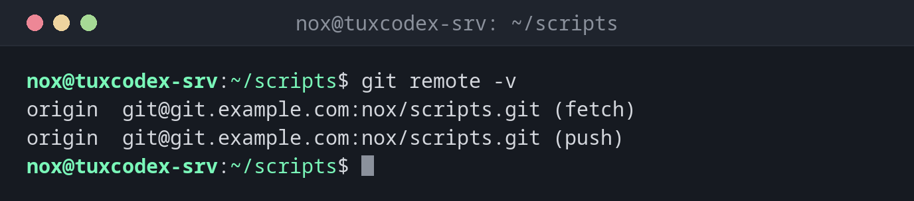

# git remote

> Manages the connections to other repositories, usually a Git server named origin.



## Syntax

```bash
git remote [-v]
git remote add NAME URL
git remote set-url NAME URL
```

## Options

| Option | Description |
|--------|-------------|
| `-v` | List the remotes with their URLs |
| `add NAME URL` | Add a new remote |
| `set-url NAME URL` | Change the URL of a remote, for example after a move |
| `rename OLD NEW` | Rename a remote |
| `remove NAME` | Remove a remote (only the connection, nothing on the server) |
| `show NAME` | Details: URLs, branches and what pull and push do |

## Examples

**Show the remotes:**

```bash
git remote -v
```

```text
origin  git@git.example.com:nox/scripts.git (fetch)
origin  git@git.example.com:nox/scripts.git (push)
```

**Connect a new repository to the server and push it:**

```bash
git remote add origin git@git.example.com:nox/scripts.git
git push -u origin main
```

```text
Enumerating objects: 27, done.
Counting objects: 100% (27/27), done.
Delta compression using up to 2 threads
Compressing objects: 100% (25/25), done.
Writing objects: 100% (27/27), 2.42 KiB | 2.42 MiB/s, done.
Total 27 (delta 8), reused 0 (delta 0), pack-reused 0 (from 0)
To git.example.com:nox/scripts.git
 * [new branch]      main -> main
branch 'main' set up to track 'origin/main'.
```

**Change the URL after a move:**

```bash
git remote set-url origin git@git.example.com:ops/scripts.git
git remote -v
```

```text
origin  git@git.example.com:ops/scripts.git (fetch)
origin  git@git.example.com:ops/scripts.git (push)
```

**Details about a remote:**

```bash
git remote show origin
```

```text
* remote origin
  Fetch URL: git@git.example.com:nox/scripts.git
  Push  URL: git@git.example.com:nox/scripts.git
  HEAD branch: main
  Remote branch:
    main tracked
  Local branch configured for 'git pull':
    main merges with remote main
  Local ref configured for 'git push':
    main pushes to main (up to date)
```

## When do I need it?

- To connect a repository created with `git init` to a Git server
- When the server or the repository path changes
- To switch from HTTPS to SSH

!!! tip "From HTTPS to SSH"
    Was the repository cloned over HTTPS and asks for a password every time?
    `git remote set-url origin git@git.example.com:nox/scripts.git` switches to SSH with your key.

## Related commands

[git clone](git-clone.md) · [git fetch](git-fetch.md) · [git push](git-push.md) · [git pull](git-pull.md)
