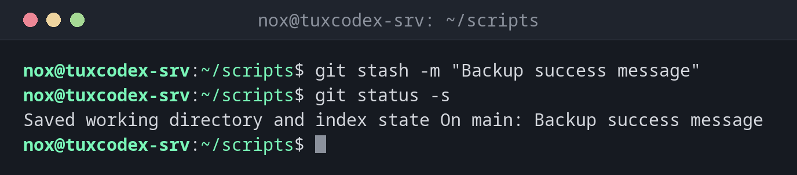

# git stash

> Puts uncommitted changes aside so you can do something else, and brings them back later.



## Syntax

```bash
git stash [push [-u] [-m "MESSAGE"]]
git stash list | show | pop | apply | drop
```

## Options

| Option | Description |
|--------|-------------|
| `push`, (none) | Put the changes aside; the working directory is clean afterwards |
| `-m MESSAGE` | Description of the stash |
| `-u`, `--include-untracked` | Also put new, untracked files aside |
| `list` | List all stashes |
| `show [-p]` | Show what a stash contains; with `-p` the full diff |
| `pop` | Bring the latest stash back and remove it from the list |
| `apply` | Bring a stash back, but keep it in the list |
| `drop`, `clear` | Delete one stash, or all of them |

## Examples

**Put changes aside:**

```bash
git stash -m "Backup success message"
git status -s
```

```text
Saved working directory and index state On main: Backup success message
```

`git status -s` shows nothing: the working directory is clean.

**List the stashes:**

```bash
git stash list
```

```text
stash@{0}: On main: Backup success message
stash@{1}: WIP on main: fcdca2b Add service check
```

**See what a stash contains:**

```bash
git stash show -p stash@{0}
```

```text
diff --git a/backup.sh b/backup.sh
index 8791eb2..895c5d1 100644
--- a/backup.sh
+++ b/backup.sh
@@ -1,3 +1,4 @@
 #!/usr/bin/env bash
 set -euo pipefail
 nice -n 10 tar --zstd -cf "/mnt/backup/www-$(date +%F).tar.zst" -C /srv www
+echo "backup done"
```

**Pull despite local changes:**

```bash
git stash
git pull -q
git stash pop
```

```text
Saved working directory and index state WIP on main: fcdca2b Add service check
On branch main
Your branch is up to date with 'origin/main'.

Changes not staged for commit:
  (use "git add <file>..." to update what will be committed)
  (use "git restore <file>..." to discard changes in working directory)
        modified:   backup.sh

no changes added to commit (use "git add" and/or "git commit -a")
Dropped refs/stash@{0} (3aa763307131275684a45b04398b6790a46878c4)
```

## When do I need it?

- When an urgent fix comes up in the middle of your work
- When `git pull` or `git switch` refuses because of local changes
- To try something out quickly and then go back to the previous state

!!! tip "Don't forget new files"
    Without `-u`, `git stash` only takes changes to files Git already tracks. New files stay
    in the working directory.

!!! warning "A stash isn't a backup"
    Stashes only exist in your local repository and are never pushed. Changes you want to
    keep belong in a commit, on a branch of their own if necessary.

## Related commands

[git restore](git-restore.md) · [git switch](git-switch.md) · [git pull](git-pull.md) · [git commit](git-commit.md)
