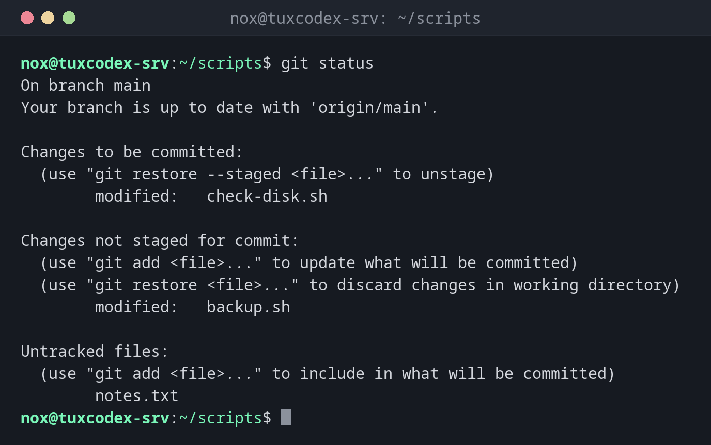

# git status

> Shows which files have changed, which changes are staged for the next commit and which files Git doesn't track yet.



## Syntax

```bash
git status [-s] [-b] [PATH...]
```

## Options

| Option | Description |
|--------|-------------|
| `-s`, `--short` | Short output, one line per file |
| `-b`, `--branch` | Also show the branch in the short output |
| `--ignored` | Also show files ignored by `.gitignore` |
| `-uno` | Don't list untracked files |

## Examples

**See the state of the repository:**

```bash
git status
```

```text
On branch main
Your branch is up to date with 'origin/main'.

Changes to be committed:
  (use "git restore --staged <file>..." to unstage)
        modified:   check-disk.sh

Changes not staged for commit:
  (use "git add <file>..." to update what will be committed)
  (use "git restore <file>..." to discard changes in working directory)
        modified:   backup.sh

Untracked files:
  (use "git add <file>..." to include in what will be committed)
        notes.txt
```

**The same in short form:**

```bash
git status -sb
```

```text
## main...origin/main
M  check-disk.sh
 M backup.sh
?? notes.txt
```

The left column is the staging area, the right one the working directory: `M` modified, `A` added, `D` deleted, `??` not tracked.

**Everything committed, but not pushed yet:**

```bash
git status
```

```text
On branch main
Your branch is ahead of 'origin/main' by 1 commit.
  (use "git push" to publish your local commits)

nothing to commit, working tree clean
```

**Also show ignored files:**

```bash
git status -s --ignored
```

```text
 M backup.sh
?? notes.txt
!! backup.log
```

## When do I need it?

- Before every commit, to see what will go into it
- On a server, to find out whether someone changed a versioned configuration by hand
- After `git pull` or `git merge`, to check whether everything went through

!!! tip "Use it all the time"
    `git status` only reads and changes nothing. Its hints also tell you which command
    undoes what, for example `git restore --staged`.

## Related commands

[git add](git-add.md) · [git diff](git-diff.md) · [git restore](git-restore.md) · [git commit](git-commit.md)
