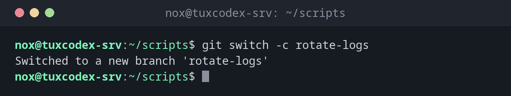

# git switch

> Switches to another branch and brings the files in the working directory to its state.



## Syntax

```bash
git switch [-c] BRANCH
```

## Options

| Option | Description |
|--------|-------------|
| `BRANCH` | Switch to this branch; if it only exists on the server, Git creates it locally |
| `-c NAME`, `--create` | Create a new branch and switch to it |
| `-` | Switch back to the previous branch |
| `--detach COMMIT` | Look at a commit or tag without a branch (detached HEAD) |
| `--discard-changes` | Switch even if local changes are lost |

## Examples

**Create a new branch and switch to it:**

```bash
git switch -c rotate-logs
```

```text
Switched to a new branch 'rotate-logs'
```

**Back to main:**

```bash
git switch main
```

```text
Switched to branch 'main'
Your branch is up to date with 'origin/main'.
```

**Work on a branch that so far only exists on the server:**

```bash
git switch nginx-tls
```

```text
Switched to a new branch 'nginx-tls'
branch 'nginx-tls' set up to track 'origin/nginx-tls'.
```

**Look at an old version:**

```bash
git switch --detach v1.0
```

```text
HEAD is now at 3fcc96a Also check /mnt/backup
```

`git switch -` takes you back to the branch you came from.

**Uncommitted changes in the way:**

```bash
git switch fix-paths
```

```text
error: Your local changes to the following files would be overwritten by checkout:
        check-disk.sh
Please commit your changes or stash them before you switch branches.
Aborting
```

Commit the change first, or put it aside with [`git stash`](git-stash.md).

## When do I need it?

- To start a new change on its own branch
- To go back and forth between your work and `main`, for example for an urgent fix
- To look at an old version, such as the one marked with a tag

!!! tip "git checkout does the same"
    Older guides use `git checkout BRANCH` and `git checkout -b NAME`. `git switch` is the
    newer command and only does this one job.

## Related commands

[git branch](git-branch.md) · [git merge](git-merge.md) · [git stash](git-stash.md) · [git restore](git-restore.md)
