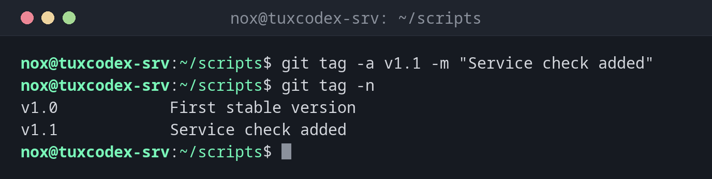

# git tag

> Gives a commit a permanent name, usually a version number such as v1.0.



## Syntax

```bash
git tag [-a NAME [-m "MESSAGE"] [COMMIT]]
```

## Options

| Option | Description |
|--------|-------------|
| (none) | List all tags |
| `-a NAME` | Create an annotated tag with author, date and message |
| `-m MESSAGE` | Message of the tag |
| `COMMIT` | Tag this commit instead of the current one |
| `-l PATTERN` | Only list tags that match the pattern, such as `"v1.*"` |
| `-n` | Also show the message of each tag |
| `-d NAME` | Delete a local tag |

## Examples

**Tag the current state as a new version:**

```bash
git tag -a v1.1 -m "Service check added"
git tag -n
```

```text
v1.0            First stable version
v1.1            Service check added
```

**Tag an older commit:**

```bash
git tag -a v0.9 0487470 -m "First scripts"
git tag -l "v0*"
```

```text
v0.9
```

**Show what a tag points to:**

```bash
git show --no-patch v1.0
```

```text
tag v1.0
Tagger: Nox <nox@example.com>
Date:   Thu Oct 22 11:05:13 2026 +0200

First stable version

commit 3fcc96a03d03b18b18a33eaf4ad512124ab1d11e (tag: v1.0)
Author: Nox <nox@example.com>
Date:   Thu Oct 22 11:05:13 2026 +0200

    Also check /mnt/backup
```

**Send a tag to the server:**

```bash
git push origin v1.1
```

```text
Enumerating objects: 1, done.
Counting objects: 100% (1/1), done.
Writing objects: 100% (1/1), 172 bytes | 172.00 KiB/s, done.
Total 1 (delta 0), reused 0 (delta 0), pack-reused 0 (from 0)
To git.example.com:nox/scripts.git
 * [new tag]         v1.1 -> v1.1
```

## When do I need it?

- To mark the state that runs in production, so you can find it again at any time
- To give scripts or roles version numbers that others can refer to
- To quickly go back to a known good state after a failed change

!!! warning "git push doesn't send tags"
    A plain `git push` only sends branches. Push a tag with `git push origin v1.1`, or all
    annotated tags along with the commits using `git push --follow-tags`.

## Related commands

[git log](git-log.md) · [git push](git-push.md) · [git switch](git-switch.md) · [git diff](git-diff.md)
