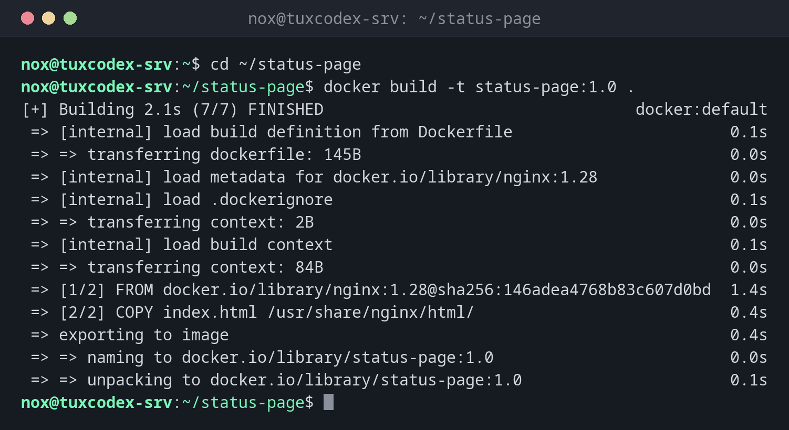

# docker build

> Builds an image from a Dockerfile and the files in a directory.



## Syntax

```bash
docker build [OPTIONS] DIRECTORY
```

## Options

| Option | Description |
|--------|-------------|
| `DIRECTORY` | Build context: the directory with the Dockerfile and the files it copies, often `.` |
| `-t`, `--tag NAME:TAG` | Name and version of the new image, can be given several times |
| `-f`, `--file FILE` | Use another Dockerfile |
| `--no-cache` | Rebuild every step instead of reusing earlier results |
| `--pull` | Always fetch the newest version of the base image |
| `--build-arg NAME=VALUE` | Set a value for an `ARG` in the Dockerfile |
| `--progress plain` | Plain output with all lines, useful for logs and errors |

## Examples

**Build an image from the current directory:**

```bash
cd ~/status-page
docker build -t status-page:1.0 .
```

```text
[+] Building 2.1s (7/7) FINISHED                                 docker:default
 => [internal] load build definition from Dockerfile                       0.1s
 => => transferring dockerfile: 145B                                       0.0s
 => [internal] load metadata for docker.io/library/nginx:1.28              0.0s
 => [internal] load .dockerignore                                          0.1s
 => => transferring context: 2B                                            0.0s
 => [internal] load build context                                          0.1s
 => => transferring context: 84B                                           0.0s
 => [1/2] FROM docker.io/library/nginx:1.28@sha256:146adea4768b83c607d0bd  1.4s
 => [2/2] COPY index.html /usr/share/nginx/html/                           0.4s
 => exporting to image                                                     0.4s
 => => naming to docker.io/library/status-page:1.0                         0.0s
 => => unpacking to docker.io/library/status-page:1.0                      0.1s
```

**The Dockerfile for it:**

```bash
cat ~/status-page/Dockerfile
```

```text
FROM nginx:1.28
COPY index.html /usr/share/nginx/html/
HEALTHCHECK CMD curl -fs http://localhost/ || exit 1
```

**Rebuild after a change, with the cache:**

```bash
docker build -t status-page:1.1 .
```

```text
[+] Building 1.1s (7/7) FINISHED                                 docker:default
 => [internal] load build definition from Dockerfile                       0.1s
 => [internal] load build context                                          0.1s
 => => transferring context: 86B                                           0.0s
 => CACHED [1/2] FROM docker.io/library/nginx:1.28@sha256:146adea4768b83c  0.1s
 => [2/2] COPY index.html /usr/share/nginx/html/                           0.1s
 => exporting to image                                                     0.4s
 => => naming to docker.io/library/status-page:1.1                         0.0s
```

`CACHED` means Docker reused the result of that step. Only the steps after the first change are run again.

**Tag the image for your registry right away:**

```bash
docker build -q -t registry.example.com/nox/status-page:1.1 .
```

```text
sha256:807c3828e0a86c119b6fc13680f7d9e2c08b7a5e4f1d3c6b9a2e8f0d4c7b1a35
```

## When do I need it?

- To package your own application or a customized service as an image
- To add your configuration or certificates to an official image
- In a CI/CD pipeline that builds an image with every change

!!! tip "Keep the build context small"
    Docker sends the whole directory to the build. A `.dockerignore` file (same syntax as
    `.gitignore`) keeps out `.git`, logs and other large files.

!!! danger "No secrets in the image"
    Every file you `COPY` stays in the image, even if a later step deletes it. Anyone who
    can pull the image can read it. Pass passwords and keys at runtime instead.

## Related commands

[docker images](docker-images.md) · [docker push](docker-push.md) · [docker run](docker-run.md) · [docker compose](docker-compose.md)
