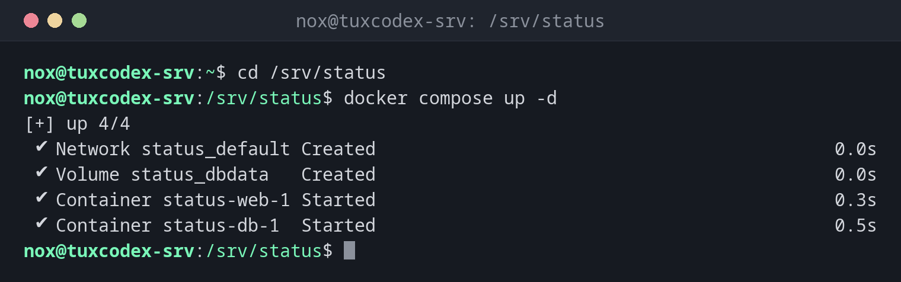

# docker compose

> Starts, updates and stops a whole stack of containers described in a compose.yaml.



## Syntax

```bash
docker compose [-f FILE] COMMAND [OPTIONS] [SERVICE...]
```

## Options

| Option | Description |
|--------|-------------|
| `up -d` | Create and start all services in the background; changed services are recreated |
| `down` | Stop and remove the containers and the network (volumes stay, unless `-v`) |
| `ps` | Show the containers of the project |
| `logs [-f] [SERVICE]` | Show the output of all or individual services |
| `pull` | Download newer versions of the images |
| `restart [SERVICE]` | Restart services |
| `exec SERVICE COMMAND` | Run a command in a service's container |
| `config` | Check the file and show the complete configuration |
| `-f FILE` | Another file instead of `compose.yaml` in the current directory |

## Examples

**Start the stack from the compose.yaml:**

```bash
cd /srv/status
docker compose up -d
```

```text
[+] up 4/4
 ✔ Network status_default Created                                           0.0s
 ✔ Volume status_dbdata   Created                                           0.0s
 ✔ Container status-web-1 Started                                           0.3s
 ✔ Container status-db-1  Started                                           0.5s
```

Compose names everything after the directory (`status`) and the service. The file itself is shown in the [basics](basics.md).

**The containers of the project:**

```bash
docker compose ps
```

```text
NAME           IMAGE         COMMAND                  SERVICE   CREATED         STATUS         PORTS
status-db-1    postgres:17   "docker-entrypoint.s…"   db        2 minutes ago   Up 2 minutes   5432/tcp
status-web-1   nginx:1.28    "/docker-entrypoint.…"   web       2 minutes ago   Up 2 minutes   0.0.0.0:8080->80/tcp, [::]:8080->80/tcp
```

**The logs of all services:**

```bash
docker compose logs --tail 2
```

```text
web-1  | 2026/10/26 09:40:05 [notice] 1#1: start worker process 29
web-1  | 2026/10/26 09:40:05 [notice] 1#1: start worker process 30
db-1   | 2026-10-26 09:40:07.102 UTC [1] LOG:  database system is ready to accept connections
db-1   | 2026-10-26 09:40:07.104 UTC [62] LOG:  database system was shut down at 2026-10-26 09:40:06 UTC
```

**Update all services:**

```bash
docker compose pull
docker compose up -d
```

```text
[+] pull 2/2
 ✔ Image postgres:17 Pulled                                                 1.7s
 ✔ Image nginx:1.28  Pulled                                                 1.6s
[+] up 2/2
 ✔ Container status-db-1  Running                                           0.0s
 ✔ Container status-web-1 Recreated                                         0.4s
```

Only `web` had a new image, so only its container was recreated. `db` kept running.

**Stop and remove the stack:**

```bash
docker compose down
```

```text
[+] down 3/3
 ✔ Container status-db-1  Removed                                           0.5s
 ✔ Container status-web-1 Removed                                           0.4s
 ✔ Network status_default Removed                                           0.1s
```

The volume `status_dbdata` stays, so the database is still there at the next `up`.

## When do I need it?

- For every service that consists of more than one container, such as an app with a database
- To document the setup of a server in a file that can go into Git
- To update all containers of a stack with two commands

!!! tip "Updating a stack"
    `docker compose pull` followed by `docker compose up -d` brings all services to the
    newest image of their tag. Only containers whose image or configuration changed are
    recreated.

!!! warning "docker-compose with a hyphen is the old version"
    `docker-compose` (with a hyphen) is Compose version 1, which is no longer maintained.
    The current version is the plugin `docker compose` (with a space). The `compose.yaml`
    files are largely the same.

!!! danger "down -v deletes the data"
    `docker compose down -v` also deletes the volumes of the project, and with them the
    database. Leave out `-v` unless you really want to start from scratch.

## Distribution differences

| | Debian | Ubuntu | RHEL | Arch |
|---|--------|--------|------|------|
| Command | `docker compose` (`docker-compose-plugin`) | `docker compose` (`docker-compose-plugin`) | `docker compose` (`docker-compose-plugin`), or `podman compose` | `docker compose` (`docker-compose`) |

## Related commands

[docker run](docker-run.md) · [docker pull](docker-pull.md) · [docker logs](docker-logs.md) · [docker volume](docker-volume.md)
