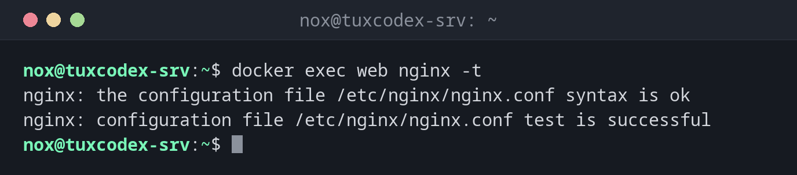

# docker exec

> Führt einen Befehl in einem laufenden Container aus, zum Beispiel eine Shell.



## Syntax

```bash
docker exec [OPTIONEN] CONTAINER BEFEHL [ARG...]
```

## Optionen

| Option | Beschreibung |
|--------|--------------|
| `-it` | Interaktiv mit Terminal, nötig für eine Shell |
| `-u`, `--user BENUTZER` | Als dieser Benutzer ausführen, etwa `root` oder `postgres` |
| `-w`, `--workdir VERZ` | Arbeitsverzeichnis im Container |
| `-e NAME=WERT` | Eine Umgebungsvariable für den Befehl setzen |
| `-d`, `--detach` | Den Befehl im Hintergrund ausführen |

## Beispiele

**Die nginx-Konfiguration im Container testen:**

```bash
docker exec web nginx -t
```

```text
nginx: the configuration file /etc/nginx/nginx.conf syntax is ok
nginx: configuration file /etc/nginx/nginx.conf test is successful
```

**Eine Shell im Container öffnen:**

```bash
docker exec -it web bash
```

```text
root@0d306f9f64bf:/# head -1 /etc/os-release
PRETTY_NAME="Debian GNU/Linux 13 (trixie)"
root@0d306f9f64bf:/# exit
```

Der Hostname im Prompt ist die Container-ID. `exit` verlässt die Shell, der Container läuft weiter.

**Einen Datenbank-Dump erstellen:**

```bash
docker exec -u postgres db pg_dumpall > /mnt/backup/db-$(date +%F).sql
ls -lh /mnt/backup/db-*.sql
```

```text
-rw-r--r-- 1 nox nox 4.2M Oct 26 10:42 /mnt/backup/db-2026-10-26.sql
```

**psql als Datenbankbenutzer öffnen:**

```bash
docker exec -it -u postgres db psql -c '\l'
```

```text
                                                    List of databases
   Name    |  Owner   | Encoding | Locale Provider |  Collate   |   Ctype    | Locale | ICU Rules |   Access privileges
-----------+----------+----------+-----------------+------------+------------+--------+-----------+-----------------------
 postgres  | postgres | UTF8     | libc            | en_US.utf8 | en_US.utf8 |        |           |
 template0 | postgres | UTF8     | libc            | en_US.utf8 | en_US.utf8 |        |           | =c/postgres          +
           |          |          |                 |            |            |        |           | postgres=CTc/postgres
 template1 | postgres | UTF8     | libc            | en_US.utf8 | en_US.utf8 |        |           | =c/postgres          +
           |          |          |                 |            |            |        |           | postgres=CTc/postgres
(3 rows)
```

## Wann brauche ich das?

- Um sich in einem Container umzusehen, wenn etwas nicht funktioniert
- Um eine Konfiguration zu testen oder einen Dienst im Container neu zu laden
- Um einen Datenbank-Dump zu erstellen oder Wartungsbefehle auszuführen

!!! tip "Keine bash im Image?"
    Kleine Images, etwa auf Alpine-Basis, haben oft nur `sh`. Nimm dort
    `docker exec -it CONTAINER sh`.

!!! warning "Änderungen im Container sind vorübergehend"
    Was du mit `docker exec` von Hand änderst, ist weg, sobald der Container neu angelegt
    wird, etwa nach einem Update. Dauerhafte Änderungen gehören ins Image, in die
    `compose.yaml` oder in eine eingehängte Konfigurationsdatei.

## Verwandte Befehle

[docker run](docker-run.md) · [docker logs](docker-logs.md) · [docker inspect](docker-inspect.md) · [docker compose](docker-compose.md)
