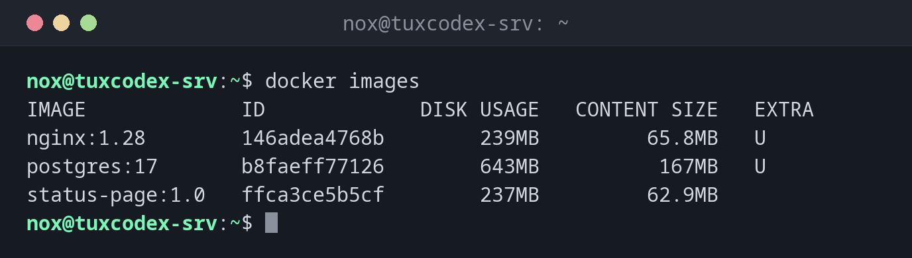

# docker images

> Listet die Images auf, die auf dem Host gespeichert sind.



## Syntax

```bash
docker images [OPTIONEN] [NAME[:TAG]]
```

## Optionen

| Option | Beschreibung |
|--------|--------------|
| `NAME[:TAG]` | Nur Images mit diesem Namen, etwa `nginx` |
| `-a`, `--all` | Auch Zwischen-Images zeigen |
| `-q`, `--quiet` | Nur die Image-IDs |
| `-f`, `--filter FILTER` | Filter, etwa `dangling=true` (Images ohne Namen) |
| `--digests` | Auch den Digest zeigen (den genauen Fingerabdruck des Images) |
| `--format VORLAGE` | Die Spalten auswählen |

`docker image ls` ist derselbe Befehl unter seinem neueren Namen.

## Beispiele

**Alle Images auflisten:**

```bash
docker images
```

```text
IMAGE             ID             DISK USAGE   CONTENT SIZE   EXTRA
nginx:1.28        146adea4768b        239MB         65.8MB   U
postgres:17       b8faeff77126        643MB          167MB   U
status-page:1.0   ffca3ce5b5cf        237MB         62.9MB
```

`U` in der Spalte EXTRA heißt, dass ein Container das Image nutzt. DISK USAGE ist die entpackte Größe auf der Platte, CONTENT SIZE der komprimierte Download.

**Nur die Images eines Namens:**

```bash
docker images nginx
```

```text
IMAGE        ID             DISK USAGE   CONTENT SIZE   EXTRA
nginx:1.28   146adea4768b        239MB         65.8MB   U
nginx:1.27   5ed8fcc66f4e        236MB         64.9MB
```

**Images ohne Namen (bleiben nach Builds übrig):**

```bash
docker images -f dangling=true -q
```

```text
3b9c4f7e21a0
```

## Wann brauche ich das?

- Um zu sehen, welche Images und Versionen auf dem Server liegen
- Um herauszufinden, wie viel Platz die Images belegen
- Vor dem Aufräumen, um alte und ungenutzte Images zu finden

!!! tip "Ältere Docker-Versionen sehen anders aus"
    Vor Docker 29 zeigte `docker images` die Spalten REPOSITORY, TAG, IMAGE ID, CREATED und
    SIZE. Die `docker.io`-Pakete von Debian und Ubuntu zeigen noch diese Darstellung.

## Verwandte Befehle

[docker pull](docker-pull.md) · [docker rmi](docker-rmi.md) · [docker build](docker-build.md) · [docker system](docker-system.md)
