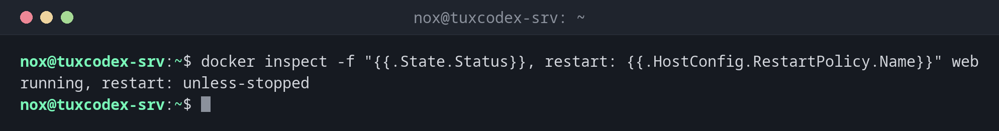

# docker inspect

> Zeigt alle Details eines Containers, Images, Volumes oder Netzwerks als JSON.



## Syntax

```bash
docker inspect [-f VORLAGE] NAME...
```

## Optionen

| Option | Beschreibung |
|--------|--------------|
| `NAME` | Container, Image, Volume oder Netzwerk |
| `-f`, `--format VORLAGE` | Nur ausgewählte Werte zeigen, etwa `"{{.State.Status}}"` |
| `--type TYP` | Nur diesen Typ suchen: `container`, `image`, `volume`, `network` |
| `-s`, `--size` | Auch die Größe zeigen (Container) |

## Beispiele

**Status und Restart-Regel:**

```bash
docker inspect -f "{{.State.Status}}, restart: {{.HostConfig.RestartPolicy.Name}}" web
```

```text
running, restart: unless-stopped
```

**Wo die Daten liegen:**

```bash
docker inspect -f "{{json .Mounts}}" db
```

```text
[{"Type":"volume","Name":"pgdata","Source":"/var/lib/docker/volumes/pgdata/_data","Destination":"/var/lib/postgresql/data","Driver":"local","Mode":"z","RW":true,"Propagation":""}]
```

**IP-Adresse in jedem Netzwerk:**

```bash
docker inspect -f "{{range $n, $c := .NetworkSettings.Networks}}{{$n}}: {{$c.IPAddress}} {{end}}" db
```

```text
backend: 172.19.0.2 bridge: 172.17.0.3
```

**Der Anfang der vollständigen Ausgabe:**

```bash
docker inspect db | head -20
```

```text
[
    {
        "Id": "f1971ec6019cd6b63bec27e35dd69ceae4e9504716d98e74ba691b6989040cae",
        "Created": "2026-10-26T07:41:05.713664518Z",
        "Path": "docker-entrypoint.sh",
        "Args": [
            "postgres"
        ],
        "State": {
            "Status": "running",
            "Running": true,
            "Paused": false,
            "Restarting": false,
            "OOMKilled": false,
            "Dead": false,
            "Pid": 1077,
            "ExitCode": 0,
            "Error": "",
            "StartedAt": "2026-10-26T07:41:06.299818118Z",
            "FinishedAt": "0001-01-01T00:00:00Z"
```

## Wann brauche ich das?

- Um herauszufinden, wo die Daten eines Containers liegen
- Um IP-Adresse, Restart-Regel oder Umgebungsvariablen eines Containers zu prüfen
- Um in Skripten und Monitoring-Checks einzelne Werte auszulesen

!!! tip "Mit jq lesbarer"
    `docker inspect web | jq '.[0].NetworkSettings.Networks'` holt einen Teil des JSON
    heraus, ganz ohne Vorlagen.

!!! warning "Passwörter im Klartext"
    `docker inspect` zeigt alle Umgebungsvariablen, auch Passwörter wie
    `POSTGRES_PASSWORD`. Sei vorsichtig, wenn du die Ausgabe weitergibst. Für sensible Werte
    sind Secrets oder Dateien besser als Umgebungsvariablen.

## Verwandte Befehle

[docker ps](docker-ps.md) · [docker volume](docker-volume.md) · [docker network](docker-network.md) · [jq](../05-text-processing/jq.md)
