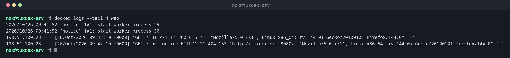

# docker logs

> Zeigt die Ausgabe eines Containers: alles, was der Dienst auf stdout und stderr schreibt.



## Syntax

```bash
docker logs [OPTIONEN] CONTAINER
```

## Optionen

| Option | Beschreibung |
|--------|--------------|
| `-f`, `--follow` | Neue Zeilen fortlaufend zeigen, wie `tail -f` |
| `-n N`, `--tail N` | Nur die letzten N Zeilen |
| `--since ZEIT` | Nur Zeilen seit einem Zeitpunkt, etwa `10m`, `2h` oder `2026-10-26T09:00` |
| `--until ZEIT` | Nur Zeilen bis zu einem Zeitpunkt |
| `-t`, `--timestamps` | Vor jeder Zeile einen Zeitstempel zeigen |

## Beispiele

**Die letzten Zeilen eines Containers:**

```bash
docker logs --tail 4 web
```

```text
2026/10/26 09:41:52 [notice] 1#1: start worker process 29
2026/10/26 09:41:52 [notice] 1#1: start worker process 30
198.51.100.23 - - [26/Oct/2026:09:42:10 +0000] "GET / HTTP/1.1" 200 615 "-" "Mozilla/5.0 (X11; Linux x86_64; rv:144.0) Gecko/20100101 Firefox/144.0" "-"
198.51.100.23 - - [26/Oct/2026:09:42:10 +0000] "GET /favicon.ico HTTP/1.1" 404 153 "http://tuxdex-srv:8080/" "Mozilla/5.0 (X11; Linux x86_64; rv:144.0) Gecko/20100101 Firefox/144.0" "-"
```

**Neue Zeilen live verfolgen:**

```bash
docker logs -f --tail 0 web
```

```text
198.51.100.23 - - [26/Oct/2026:09:42:31 +0000] "GET /status HTTP/1.1" 404 153 "-" "curl/8.14.1" "-"
^C
```

Beenden mit ++ctrl+c++; der Container läuft weiter.

**Herausfinden, warum ein Container nicht startet:**

```bash
docker logs pg-new
```

```text
Error: Database is uninitialized and superuser password is not specified.
       You must specify POSTGRES_PASSWORD to a non-empty value for the
       superuser. For example, "-e POSTGRES_PASSWORD=password" on "docker run".
```

**Nur die letzte Stunde, mit Zeitstempeln:**

```bash
docker logs -t --since 1h db
```

```text
2026-10-26T09:12:04.517802311Z 2026-10-26 09:12:04.517 UTC [27] LOG:  checkpoint starting: time
2026-10-26T09:12:09.183224019Z 2026-10-26 09:12:09.183 UTC [27] LOG:  checkpoint complete: wrote 47 buffers (0.3%); 0 WAL file(s) added, 0 removed, 0 recycled; write=4.611 s, sync=0.021 s, total=4.666 s
```

## Wann brauche ich das?

- Wenn ein Container nicht startet oder ständig neu startet
- Um beim Testen das Zugriffslog eines Webservers mitzulesen
- Um nachzusehen, was in der Nacht passiert ist

!!! tip "Logs nur, wo der Dienst sie hinschreibt"
    `docker logs` zeigt nur, was der Prozess auf stdout und stderr schreibt. Die meisten
    offiziellen Images sind so eingerichtet. Dienste, die in Dateien im Container schreiben,
    brauchen ein Volume für ihre Logs.

!!! warning "Logs wachsen unbegrenzt"
    Standardmäßig speichert Docker die Logs eines Containers in einer JSON-Datei ohne
    Größengrenze. Begrenze sie in `/etc/docker/daemon.json` mit
    `"log-opts": {"max-size": "10m", "max-file": "3"}` und starte Docker neu.

## Verwandte Befehle

[docker ps](docker-ps.md) · [docker exec](docker-exec.md) · [docker compose](docker-compose.md) · [journalctl](../09-systemd/journalctl.md)
