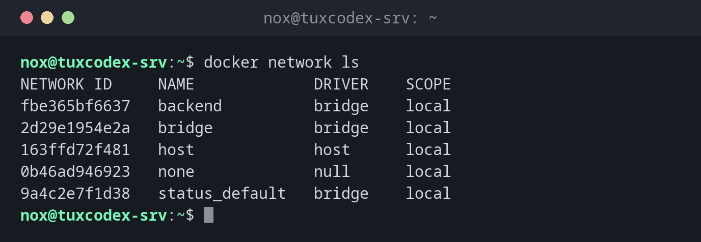

# docker network

> Verwaltet die Netzwerke, über die Container einander und die Außenwelt erreichen.



## Syntax

```bash
docker network create | ls | inspect | connect | disconnect | rm NAME
```

## Optionen

| Option | Beschreibung |
|--------|--------------|
| `ls` | Alle Netzwerke auflisten |
| `create NAME` | Ein Netzwerk anlegen (standardmäßig mit dem Treiber `bridge`) |
| `--subnet CIDR` | Mit `create`: den Adressbereich selbst festlegen |
| `inspect NAME` | Details, auch die verbundenen Container und ihre Adressen |
| `connect NETZWERK CONTAINER` | Einen laufenden Container mit einem Netzwerk verbinden |
| `disconnect NETZWERK CONTAINER` | Die Verbindung wieder trennen |
| `rm NAME` | Ein Netzwerk ohne Container löschen |

## Beispiele

**Die Netzwerke auflisten:**

```bash
docker network ls
```

```text
NETWORK ID     NAME             DRIVER    SCOPE
fbe365bf6637   backend          bridge    local
2d29e1954e2a   bridge           bridge    local
163ffd72f481   host             host      local
0b46ad946923   none             null      local
9a4c2e7f1d38   status_default   bridge    local
```

**Ein Netzwerk anlegen und zwei Container verbinden:**

```bash
docker network create backend
docker network connect backend db
docker network connect backend web
```

```text
fbe365bf663770cd04d43339a0289899c0d4fbd4e9a589ab0beed205d20152cf
```

**Den anderen Container über den Namen erreichen:**

```bash
docker exec web getent hosts db
```

```text
172.19.0.2      db
```

**Welche Container in einem Netzwerk sind:**

```bash
docker network inspect backend -f "{{range .Containers}}{{.Name}} {{.IPv4Address}}  {{end}}"
```

```text
db 172.19.0.2/16  web 172.19.0.3/16
```

## Wann brauche ich das?

- Damit Container wie eine Web-Anwendung und ihre Datenbank einander über den Namen erreichen
- Um Gruppen von Containern voneinander zu trennen
- Wenn sich die Adressbereiche von Docker mit einem Netz in der Firma überschneiden

!!! tip "Namen statt IP-Adressen"
    In einem selbst angelegten Netzwerk (und in jedem Compose-Projekt) erreichen sich
    Container über ihren Namen: Die Web-Anwendung verbindet sich mit `db:5432`. Im
    Standardnetzwerk `bridge` klappt das nicht.

!!! warning "Adresskonflikte"
    Docker nutzt Bereiche ab 172.17.0.0/16. Verwendet die Firma oder das VPN denselben
    Bereich, kollidieren die Routen. Leg in `/etc/docker/daemon.json` unter
    `default-address-pools` andere Bereiche fest.

## Verwandte Befehle

[docker run](docker-run.md) · [docker inspect](docker-inspect.md) · [docker compose](docker-compose.md) · [ip](../11-network/ip.md)
