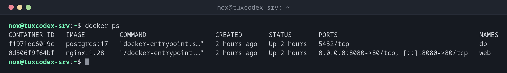

# docker ps

> Listet die Container auf: standardmäßig die laufenden, mit `-a` alle.



## Syntax

```bash
docker ps [OPTIONEN]
```

## Optionen

| Option | Beschreibung |
|--------|--------------|
| `-a`, `--all` | Auch gestoppte Container zeigen |
| `-q`, `--quiet` | Nur die Container-IDs, für Skripte |
| `-f`, `--filter FILTER` | Filter, etwa `status=exited`, `name=web` oder `ancestor=nginx:1.28` |
| `--format VORLAGE` | Die Spalten auswählen, etwa `"{{.Names}}\t{{.Status}}"` |
| `-s`, `--size` | Auch die Größe der beschreibbaren Schicht jedes Containers zeigen |
| `-n N`, `-l` | Nur die letzten N angelegten Container oder den neuesten |

## Beispiele

**Die laufenden Container zeigen:**

```bash
docker ps
```

```text
CONTAINER ID   IMAGE         COMMAND                  CREATED       STATUS       PORTS                                     NAMES
f1971ec6019c   postgres:17   "docker-entrypoint.s…"   2 hours ago   Up 2 hours   5432/tcp                                  db
0d306f9f64bf   nginx:1.28    "/docker-entrypoint.…"   2 hours ago   Up 2 hours   0.0.0.0:8080->80/tcp, [::]:8080->80/tcp   web
```

**Auch gestoppte Container zeigen:**

```bash
docker ps -a
```

```text
CONTAINER ID   IMAGE         COMMAND                  CREATED       STATUS                  PORTS                                     NAMES
7b2e91c4d0a3   postgres:17   "docker-entrypoint.s…"   3 days ago    Exited (0) 3 days ago                                             pg-test
f1971ec6019c   postgres:17   "docker-entrypoint.s…"   2 hours ago   Up 2 hours              5432/tcp                                  db
0d306f9f64bf   nginx:1.28    "/docker-entrypoint.…"   2 hours ago   Up 2 hours              0.0.0.0:8080->80/tcp, [::]:8080->80/tcp   web
```

**Nur Name und Status:**

```bash
docker ps -a --format "{{.Names}}\t{{.Status}}"
```

```text
pg-test Exited (0) 3 days ago
db      Up 2 hours
web     Up 2 hours
```

**IDs aller gestoppten Container:**

```bash
docker ps -aq -f status=exited
```

```text
7b2e91c4d0a3
```

## Wann brauche ich das?

- Um zu sehen, welche Container laufen und seit wann
- Um herauszufinden, welche Ports ein Container veröffentlicht
- Um Container zu finden, die gestoppt sind oder ständig neu starten

!!! tip "Auf die Spalte STATUS achten"
    `Restarting (1) 5 seconds ago` heißt: Der Container stürzt immer wieder ab. Der Grund
    steht fast immer in [`docker logs`](docker-logs.md).

## Verwandte Befehle

[docker run](docker-run.md) · [docker stats](docker-stats.md) · [docker inspect](docker-inspect.md) · [docker logs](docker-logs.md)
